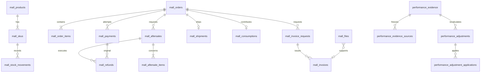

# Data Model: 自营独立商城

日期：2026-11-04；状态：逻辑/持久化设计，尚未创建模型或迁移。对应[主规格](spec.md)、[研究](research.md)和[接口](contracts/README.md)。

## 1. 通用约定

现有MySQL 8/InnoDB。新增表主键`BIGINT UNSIGNED`，业务对外ID序列化为字符串；引用现有整数ID的外键沿用其精确类型与符号，不能因本表主键BIGINT而产生不兼容FK。金额用有符号BIGINT整数分，常规金额≥0，差额可正负；数量整数且非负。JSON只存快照/限定扩展，不把可查询资金状态藏进无约束JSON。

时间统一存UTC的`DATETIME(6)`，输出RFC3339；商城`business_period CHAR(7)`由Asia/Shanghai换算并保存。旧Bill的期间过滤保持原语义，冻结期间不迁移。新表有`created_at/updated_at`；可变聚合有`version INT`供乐观校验。业务事实禁止物理删除，关系用RESTRICT或SET NULL并保留快照，不使用删除用户级联删除资金。

所有唯一约束与检查必须有迁移；MySQL版本支持CHECK实际执行需部署核验，不能仅凭ORM校验。状态使用受约束字符串，避免因扩状态必须全库改原枚举。表名/字段为计划值，契约使用camelCase。

## 2. 实体关系

## 3. 商品、库存与用户选购（6表）

| 表 | 主要字段 | 唯一性/索引与不变量 |
|---|---|---|
| `mall_categories` | id,parent_id nullable,name VARCHAR64,sort INT,status enabled/disabled,version | 同父级名称唯一须处理NULL根级（生成normalized_parent_id=0或非空根标识）；最多两级、不成环；product引用不级联删 |
| `mall_products` | id,category_id,name VARCHAR64,summary VARCHAR128,cover_file_id,gallery_file_ids JSON,description TEXT,instructions TEXT,status draft/on_sale/off_sale/archived,sort,version | index(status,sort,id),(category_id,status,sort,id)；发布检查完整性及有效SKUs；有历史不删 |
| `mall_skus` | id,product_id,sku_code VARCHAR64,options JSON,sale_price_cent,available_qty,reserved_qty,warning_qty,version,status | unique(sku_code)；available/reserved≥0，正售价；index(product_id,status)；最多20组合、2维属于商品内规则 |
| `mall_stock_movements` | id,sku_id,event_key VARCHAR128,order_item_id nullable,aftersale_item_id nullable,kind,available_delta,reserved_delta,before/after JSON,actor_type,actor_id,reason | unique(sku_id,event_key)；index(sku_id,id)；订单占用、收款转换、关闭释放、取消回库、实物验收分别独立键 |
| `mall_addresses` | id,user_id,recipient_name,phone,phone_masked,province/city/district codes,address_line,is_default,archived_at,version,consent_record_id | index(user_id,archived_at,id)；一用户一个默认用用户级锁维护，或nullable默认slot唯一；GET只脱敏，原值只用履约目的 |
| `mall_cart_items` | id,user_id,sku_id,quantity,version | unique(user_id,sku_id)，qty>0；无库存占用/消费事实；结算按当前状态重验 |

商品图与说明图片可以公开，需与票据/售后私有文件分purpose和权限；不得把同一私有对象的public URL挂进商品gallery。

## 4. 交易与资金（7表）

### 4.1 mall_orders

`id, order_no VARCHAR32 unique, buyer_user_id, status, version, currency CNY, goods_amount_cent, freight_amount_cent, payable_amount_cent, paid_amount_cent, refunded_goods_cent, refunded_freight_cent, refund_reserved_cent, address_snapshot JSON, policy_snapshot JSON, buyer_note VARCHAR200, internal_note VARCHAR200, expires_at, paid_at, business_period, shipped_at, received_at, closed_at, close_reason, active_payment_id nullable, current_invoice_request_id nullable, consent_record_id`。

索引`(buyer_user_id,created_at,id)`、`(status,created_at,id)`、`(business_period,paid_at,id)`。支付累计、退款成功及占用满足`refunded_goods+refunded_freight+refund_reserved<=paid`；退款处理中占用按售后唯一，不是每阶段重新加。所有金额及快照由可信交易计算。电话原文与详情地址快照不进普通响应/普通日志。

### 4.2 mall_order_items

`id,order_id,sku_id,product_id,product_snapshot JSON,unit_price_cent,quantity,line_amount_cent,reservation_status reserved/sold/released,returned_quantity,aftersale_reserved_quantity,refunded_goods_cent,version`。

`unique(order_id,sku_id)`（同SKU合并），index(sku_id,order_id)。`line_amount=price*quantity`；累计成功及处理中数量不超购买；商品退回量与资金累计分开，损坏验收不能用退款触发回库。商品可归档但成交信息不依赖现表回填。

### 4.3 mall_payments

`id,order_id,out_trade_no VARCHAR32,channel_transaction_id VARCHAR64 nullable,status creating/pending/unknown/succeeded/closed/failed,active_slot nullable TINYINT,amount_cent,currency,appid_snapshot,mchid_snapshot,prepay_ciphertext nullable,expires_at,confirmed_at,last_query_at,last_error_code,version`。

unique(out_trade_no)、unique(channel_transaction_id)（NULL允许多行）、unique(order_id,active_slot)，活动slot为1，终态置NULL（MySQL不能使用PostgreSQL式条件唯一索引）。同一订单活动指针与行约束同事务维护。调起参数仅在本人有效支付请求中临时签发，不缓存进通用幂等响应。

### 4.4 mall_aftersales / mall_aftersale_items

申请表：`id,aftersale_no,order_id,buyer_user_id,method refund_only/return_refund,status,reason,description,proof_file_ids JSON,goods_refund_cent,freight_refund_cent,reserved_refund_cent,audit_by,audit_reason,return_address_snapshot,return_company,return_tracking_no,return_sent_at,received_at,receipt_result,version`。

明细表：`id,aftersale_id,order_item_id,quantity,goods_refund_cent,stock_return_quantity,active_slot nullable,inspection_reason`。unique(aftersale_no)，unique(aftersale_id,order_item_id)，unique(order_item_id,active_slot)维持同明细一个有效申请。跨明细一单可申请多件，锁原订单统一限制总金额和数量。

占用在申请受理形成并持续到退款确定终态；拒绝/合法撤回释放，处理中未知不释放。仅退款跳过寄回阶段；发货前有效申请阻塞整单出库。

### 4.5 mall_refunds

`id,aftersale_id,payment_id,order_id,out_refund_no VARCHAR64,channel_refund_id nullable,status prepared/processing/unknown/succeeded/closed/abnormal/rejected_unaccepted,goods_refund_cent,freight_refund_cent,total_cent,original_amount_cent,requested_by,submitted_at,confirmed_at,last_query_at,last_error_code,version`。

unique(out_refund_no)、unique(channel_refund_id)，index(status,last_query_at)。同售后一个有效退款请求由锁+active_slot约束（增加active_slot nullable字段及unique(aftersale_id,active_slot)）。同请求安全重试复用原号；旧请求关闭后需要新请求，保存predecessor_refund_id，不混淆“未受理失败”与“资金未知”。异常不释放原额度。

### 4.6 mall_shipments

`id,order_id unique,courier_code,tracking_no,shipped_at,shipped_by,version,platform_sync_status not_required/pending/succeeded/failed/unknown,platform_last_error,platform_synced_at,platform_confirmation_status,platform_confirmed_at`。

包裹变更进审计及任务版本，不能新建第二包裹重复发货。真实出库与平台上传、平台确认分别留证；任务以shipment_id+version去重，旧版本任务不得覆盖新运单。

## 5. 票据、文件、消费与配置（5表）

| 表 | 主要字段 | 约束 |
|---|---|---|
| `mall_invoice_requests` | id,request_no,order_id,buyer_user_id,buyer_type personal/company,title,tax_no,email nullable,invoice_type,requested_goods_cent,requested_freight_cent,source_order_version,status,active_slot,claimed_by,claimed_at,version | unique(request_no)、unique(order_id,active_slot)，在途slot=1；金额不可任填；一单一有效标准申请 |
| `mall_invoices` | id,request_id,order_id,kind blue/red,invoice_no,issued_at,total_cent,seller_snapshot JSON,file_id,status,original_invoice_id nullable,replacement_for_id nullable,issued_by,recorded_by,version | unique(seller_identity,invoice_no)（seller_identity另列稳定字符串，不只JSON）；red必须关联blue，金额覆盖原票剩余；全冲重开不删历史 |
| `mall_files` | id,object_key,purpose product_image/aftersale_proof/invoice_pdf/reconciliation_evidence/finance_export,owner_actor_type,owner_actor_id,order_id nullable,invoice_id nullable,mime,size,sha256,status uploading/verified/bound/rejected,expires_at | unique(object_key)；票据PDF≤10MB、凭证JPG/PNG≤5MB；HEAD真实校验，生产缺凭据失败，signed URL不落库 |
| `mall_consumptions` | id,order_id unique,buyer_user_id,customer_id nullable,attributed_distributor_id nullable,trade_org_id nullable,name snapshots,paid_at,business_period,original_goods_cent,successful_goods_refund_cent,performance_base_cent,status unassigned/paid/partially_refunded/refunded,source_version,attribution_evidence JSON | index(distributor_id,business_period,id)、(customer_id,paid_at,id)、(status,paid_at,id)；部分退base=original，全商品退base=0；无客户不造Bill |
| `mall_settings` | id=1,version,enabled,purchase_enabled,freight_mode,freight_cent,blocked_regions JSON,payment_minutes,auto_receive_days,aftersale_days,dispatch/return address snapshots,contact,policy_versions JSON | 单主体配置而非通用配置中心；敏感值只受控交付，商户密钥不存此表；发布与下单取快照 |

票据request与file的invoice_id循环关系在文件先上传核实、绑定票据时填写，约束不级联删除，不因文件失效重开税务票据。开票申请状态不等于实际蓝红票税务状态。

## 6. 幂等、渠道与工作项（3表）

| 表 | 字段 | 约束及恢复 |
|---|---|---|
| `mall_commands` | id,actor_type,actor_id,action,key VARCHAR128,payload_hash CHAR64,status running/completed,entity_type,entity_id,lease_until,result_code,created_at | unique(actor_type,actor_id,action,key)；同键异摘要409；回查原实体时重新授权，不存明文请求或旧敏感响应。财务身份与唯一资金号永久保留 |
| `mall_gateway_events` | id,channel,event_id,event_type,resource_id,payload_ciphertext,verified_digest,received_at,status pending/applied/rejected,last_error | unique(channel,event_id)；通知原密文非解密全量日志，限定保留/访问；查单结果用业务唯一事件身份参与同处理器 |
| `mall_jobs` | id,kind,entity_type,entity_id,entity_version,dedupe_key,status ready/running/retry/done/manual,attempts,next_run_at,lease_owner,lease_until,last_error_code,started_at,finished_at | unique(dedupe_key)、index(status,next_run_at,id)、index(lease_until)；崩溃租约过期可领取；触发通知不重复库存/资金效果 |

inbox和jobs在同一提交事务建立关系；无法持久化不ACK。任务claim与finish核对lease_owner和版本，延迟旧任务无权覆盖新版本。MySQL跳锁只用于任务领取。

## 7. 人工对账（2表）

`mall_reconciliation_batches`：id,business_date,channel,seller_identity,status draft/processing/review/closed,statement_file_id,statement_sha256,expected_paid_cent,expected_refund_cent,local_paid_cent,local_refund_cent,evidence_note,created_by,reviewed_by,reviewed_at,version。unique(date,channel,seller_identity,statement_sha256)防同证据重复批次；无完整核对不能closed。

`mall_reconciliation_differences`：id,batch_id,order_id/payment_id/refund_id nullable,external_reference,difference_type,expected_cent,actual_cent,status,assigned_to,resolution,evidence_file_ids JSON,resolved_at,reviewed_at,version。保留无法关联的渠道记录，不因为缺order_id丢弃。费用和到账另在证据及核对记录分列，不能伪装订单价款。

## 8. 绩效证据、差额与应用（5表）

### 8.1 performance_period_versions

`period CHAR7 primary key, revision BIGINT, recomputed_revision nullable, status open/pending/reviewed, freeze_fingerprint nullable, updated_at`。与现有settlement一对一协调但不提前将有消费月建为pending导致不可核算。来源变化与review固定先锁此行；商城支付多笔落在同月的锁须短，不做渠道网络。

旧Bill变更与规则、人员组织变更涉及当前未冻结周期时也标记revision/dirty；涉及全组织规则或组织迁移时对受影响期间按升序锁，不能只标商城来源而放过其它输入变化。审核核对`computed_revision==revision`和输入摘要，失败409要求重算。

### 8.2 performance_evidence

`id,settlement_id,evidence_key CHAR64 unique,result_id nullable unique,period,distributor_id,rule_type,org_id,frozen_members JSON,organization_path_snapshot JSON,rule_source,rule_snapshot JSON,algorithm_version,legacy_base_cent,mall_base_cent,original_base_cent,original_commission_cent,result_presence present/not_generated,result_absence_reason nullable,input_digest,frozen_at,evidence_status complete/manual_required`。

原结果及规则源与freeze对应，不根据后来人员调动回填；管理员管理子树成员及各成员基数冻结。存量无完整证据不伪造complete。

`unique(settlement_id,distributor_id,rule_type)`及服务端生成的稳定evidence_key作为原期计算身份。冻结时为原期参与范围内所有个人/管理计算单元留证，包括已有规则但当时未命中阶梯、无结果行的单元：result_id=NULL、result_presence=not_generated、原应得0，保存原规则/范围及原因。不能为此向已冻结commission_results补零行。无有效规则、原期无资格或历史证据缺失必须明确原因并走manual_required，不用后来规则自动补出金额；仅以客户后来绑定不能证明原期资格。

### 8.3 performance_evidence_sources

`id,evidence_id,source_type bill/mall,source_id,source_version,attributed_distributor_id,calculation_org_id,occurred_at,business_period,base_cent,source_snapshot JSON`。unique(evidence_id,source_type,source_id)，index(source_type,source_id,evidence_id)。同商城来源可出现在个人及不同管理结果的证据中，这是不同绩效结果的合法作用范围，不是消费重复计入。

需要保存原Bill输入证据，不能只冻商城sum；后续旧账单退款或归属变更不得改写freeze。新核算未审核输入可重建，正式审核后只增后续事实与差额。

### 8.4 performance_adjustments

`id,adjustment_no unique,origin_period,origin_result_id nullable,evidence_id,trigger_source_type,trigger_source_id,trigger_version,beneficiary_id,rule_type,original_commission_cent,replayed_commission_cent,prior_confirmed_adjustment_cent,delta_cent,status proposed/manual_required/reviewed/rejected,reviewed_by,reviewed_at,reason,remaining_cent,version`。

unique(evidence_id,trigger_source_type,trigger_source_id,trigger_version)；先按统一锁序锁原证据锚点，存在原结果时再按约定锁该结果及对应调整，不能依赖nullable原结果ID做幂等。`delta=C*−C0−A`，A按同证据锚点累计此前已审核且未兑现的调整，不仅实际扣过的部分。原结果不存在但原期完整证据表明有资格时C0=0，按原规则模拟；origin_result_id=NULL不得阻止合法差额。未审核计算期间若有新变更须重新核实版本，不按旧delta直接确认。全商品退款可能影响多条原管理结果，各自正确产生差额。

证据不足只能人工核实并上传可追溯证据，不任填金额改渠道事实。原正式结果/核销值不改；仅调整债权与后续应用。

存量无可用锚点时，只能按原期+人员+rule_type建立明确manual_required的待核实证据记录；未取得可验证的原期资格、范围、规则和基数前不允许审核为已确认，更不能把当前配置回填成历史事实。补归属保留支付时未归属证据、支付实际月份、授权依据及各次版本，不覆盖原支付事实。

### 8.5 performance_adjustment_applications

`id,adjustment_id,target_period,target_result_id,allocated_cent,settled_cent,status allocated/consumed/cancelled,allocation_key unique,consumed_at,version`。同一差额可分期分配，target_result锁与核销同事务；allocation正负号跟delta一致，累加不得超已审核剩余。

原`commission_results.commission_cent`继续为正常绩效。新响应另提供gross、confirmedAdjustment、allocatedDebt、redeemable、pendingDebt；无调整旧字段结果不变。有且仅有调整的月份也可处理：为对应人员/类型产生正常绩效0的结算载体行并明确来源adjustment_only，正常基数0、不匹配新消费阶梯；正向额度及负债在应用中体现，不创建钱包。不能对旧冻结月份补零行改结果集合，只在当前待核算期创建载体。

后期核销按`normal + 已分配正调整 − 已分配债权`计算可兑现净额，<=0不得核销正积分。`redeemed_points_x100`保存实际净核销量，旧已核销行保持原值/时间；原正常绩效未支付但冻结的同原期间结果不直接改写，本版负调整优先后期额度，债不足留存。待结余债权不能在后期每次再次生成完整delta。

## 9. 现有表的兼容附加与迁移

- `performance_settlements`增加可空`computed_revision,input_digest,evidence_version`；旧记录NULL标legacy，不伪造冻结证据。
- `commission_results`增加`origin_kind normal/adjustment_only`及可空版本标识；不改commission_cent含义，旧记录normal。
- 现有同意场景新增商城资料目的及版本，保留已有记录，不把旧注册同意当新告知；具体表枚举迁移核实真实MySQL定义。
- 权限种子仅给明确系统管理员能力集合，不自动给所有运营/组织角色；实时鉴权新增而不改旧JWT协议。
- 不新增Bill来源mall，不改老退款/归属规则和历史归期。已有报告扩展来源查询而非重建报表系统。

计划迁移拆为024商品/订单/地址库存及配置、025资金/售后/票据/文件/任务/对账、026消费/绩效证据与差额。编号在实施时核验；降级只允许隔离空测试库，线上有事实不drop表。

## 10. 核心不变量与校验

1. `paid >= successful_refund + reserved_refund >= 0`，商品/运费各不超原分项；活动售后/退款slot与父订单指针同事务。
2. 每条资金成功事实、订单占用释放和实物入库都有唯一事件键；任何重试不能只靠前端或进程锁。
3. `available_qty/reserved_qty>=0`；支付只转换占用不二扣可售；出库记录不再次减可售。
4. 支付身份、用户、渠道主体及币种一致，预付令牌不能作为资金事实。
5. 已冻结原值、输入及核销事实不可改写；同事件delta不会重复确认或重复抵扣。
6. 文件用途及owner/order权限必须匹配，私有票据不转public，上传token不等于真实对象可用。
7. 后台审计身份不冒充users.id；不把手机号、地址、密钥、签名URL放进一般日志/响应缓存。
8. 不存在MySQL原生条件索引的误用；活动唯一采用nullable slot+父行锁，而非只在应用if判断。

## 11. 快递100补充字段（不新增表）

`mall_shipments`增加`logistics_provider VARCHAR32`、`logistics_status`、`provider_state VARCHAR32 nullable`、`tracking_identity_hash CHAR64`、`tracking_snapshot JSON`、`logistics_fetched_at`、`logistics_next_query_at`、`logistics_last_error_code`。更新按shipment.version与身份摘要条件写入；同票共享数据库限流，旧运单响应不能覆盖新版本。安全快照不含key/sign/原文手机号/私密地图访问令牌。查询签收、用户收货、微信确认分别保存。迁移仍在025包裹变更中落实，逻辑表仍28张。
