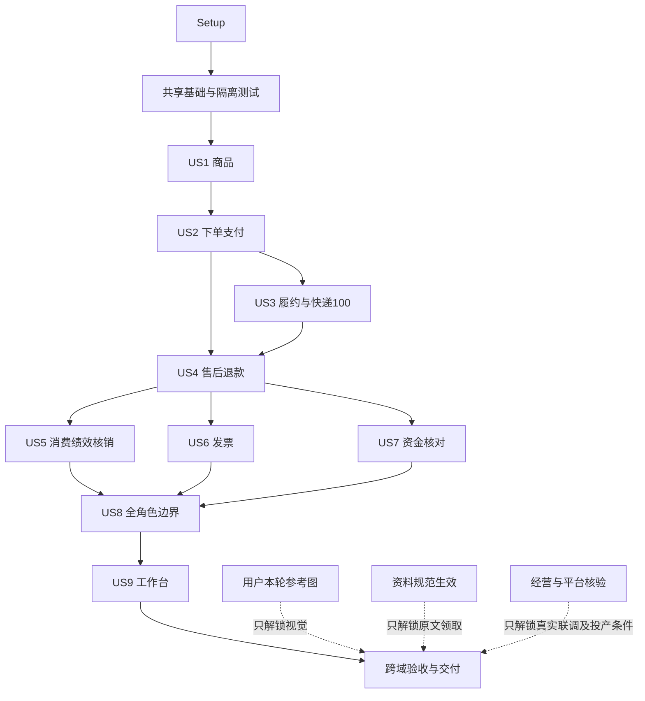

# Tasks: 自营独立商城完整闭环

**Input**: `specs/022-independent-mall/` 的产品规格、实施计划、研究、模型、契约、验收及快递100补充。  
**Branch / Date**: `022-independent-mall` / 2026-11-04。  
**Status**: 商品、订单支付、履约本地切片、售后退款、绩效消费、开票和资金对账均有本地实现与阶段验收；当前134项完成、1项进行中、0项待办，逐项状态以任务表及实施记录为准。US8的T116/T117权限矩阵、最小种子授权、撤权后导航拦截、T118权限接线、T119用途告知、T120数据边界强化及T121可执行角色/隐私矩阵回归已完成。2026-11-09用户批准商城后台单订单履约/单申请开票原文访问，宪章IV升至4.0.0；T063/T102后端接口已实现，订单和发票管理页已接入短时领取交互，前端构建通过。`VITE_MALL_DATA_RELEASE_UI_ENABLED`默认false；生产开关仍关闭，待现有留存制度引用、经审阅告知版本和界面行为验收；商城后端不自动向微信或承运商传输原文；快递100仅接收地图轨迹所需的省/市/区县名称（2026-11-11用户授权），不接收姓名、电话或详细地址。本项目没有微信平台发货环节，员工在商城后台登记本地包裹及运单即完成发货；T054/T056原人工登记/回填方案作废。宪章II限定例外已采纳、G-PROTOCOL协议已核实，T048两个回调入口及本地隔离回归已完成；生产通知注册、真实支付/退款、COS及快递100真实运单查询均未验收。未提交、推送或部署。
**Prerequisites**: [plan.md](plan.md)、[spec.md](spec.md)、[research.md](research.md)、[data-model.md](data-model.md)、[contracts/README.md](contracts/README.md)、[acceptance.md](acceptance.md)、[logistics-integration.md](logistics-integration.md)。

**Tests**: 按项目宪章I和本计划TDD要求，资金、库存、权限、票据及核算必须先有失败用例。每个“先写测试”任务须记录正确隔离环境中的预期失败原因，再执行对应实现，不以环境损坏冒充RED；测试本身无外部真实副作用。组件或服务任务内写明“先测试再实现”的，也须保留RED→GREEN记录。

**Organization**: 基础任务先完成，再按九条用户故事交付；各故事可用受控fixtures独立测试，不能因此假称依赖功能已经实现。后端和管理端先行，小程序服务可先测；视觉任务等参考图。

## 格式、路径与执行方式

每项严格为`- [ ] Tnnn [P可选] [USn故事内必需] 描述＋精确文件路径`。路径相对当前仓库`LuTaiMiniProgram/`；列出的新文件是后续任务产物，本轮未创建。文件共享时按显式依赖串行，不能因为不同故事就同时编辑同一个文件。任务内多个文件属于同一可验证切片。

`[P]`仅表示其依赖完成后可与同阶段独立文件任务并行，不表示现在即可跑，也不要求启动子代理。迁移编号实施前重新核对head；024/025跨表外键与票据文件循环引用按先建表后加约束处理。

任务后的“依赖/需求/验收/门禁”均为执行条件。完成任务才可打勾；已完成任务受新需求影响须重新核验。任务真实证据写入`implementation-log.md`，尚不存在的日志由首项任务创建。

## 阶段门禁

| 门禁 | 何时满足 | 当前与未满足时的处理 |
|---|---|---|
| G-PROTOCOL | [外部通知协议](protocol-governance-proposal.md)已由宪章3.0.0正式采纳，官方商户支付/退款通知协议已核验，T048专用实现与隔离回归已完成 | 本地治理与实现门禁已通过；生产通知登记、部署与真实资金仍受G-LIVE及具体授权约束 |
| ~~G-LIVE-SHIPPING~~ | 已移除：本项目不存在微信平台发货环节 | 2026-11-11按用户确认移除，不再作为门禁或验收条件 |
| G-DATA | [批准范围](governance-proposal.md)及宪章4.0.0的内部单对象例外已采纳；T063/T102实现和合成契约回归已完成 | 内部实现范围通过；生产运行开关仍要求现有留存制度引用和经审阅告知版本。任何外部接收方传输仍未批准并须单独核验授权；普通接口继续脱敏 |
| G-UI | 将要开展小程序视觉设计前先提醒用户，取得本轮风格参考图并记录采用边界 | 2026-11-06用户已提供商城商品列表截图；T003已归档布局边界及本项目配色，商城视觉页面可继续按该风格实现 |
| G-LIVE | 经营主体/商品/仓退/支付开票/快递100具体权益与环境核验，且具体真实操作有授权 | 快递100客户号、密钥已配置，live分支已在本地development接通，仅发送行政区名称；真实运单查询、额度与错误状态未核验；无真实支付退款/开票调用 |

参考图收集任务列在Setup作为视觉前置记录，已于2026-11-06完成；商城视觉页面按归档风格和页面边界继续实现。故事未完成的UI项不得打勾。G-DATA内部访问范围已批准；生产配置和外部数据传输仍受各自独立门禁约束。

## Phase 1: Setup — 输入、隔离与执行记录

**Goal**: 核验活动文档、范围与隔离测试条件，不初始化另一套项目。

**Independent Test**: 文档、分支和schema契约可追踪；没有真实外部调用。

- [x] T001 核验022分支、全部文档、依赖锁和迁移head，记录基线、现有失败及本轮TDD证据格式；禁止覆盖先前文档；纳入用户已开通快递100的补充，不假定订阅、面单和额度已核验（文件：`specs/022-independent-mall/implementation-log.md`, `backend/migrations/versions/023_article_videos.py`；依赖：无；需求：FR-001, FR-002, FR-003, FR-094）。
- [x] T002 登记G-DATA/G-UI/G-LIVE与明确默认值，建立证据栏；不把提案写成生效、不现在索要图片或自动开生产权限；增加G-PROTOCOL及G-LIVE-SHIPPING子项，协议草案不等于采纳；通知实施受阻，其它非通知工作可先行（文件：`specs/022-independent-mall/governance-proposal.md`, `specs/022-independent-mall/implementation-log.md`, `specs/022-independent-mall/protocol-governance-proposal.md`；依赖：T001；需求：FR-038, FR-058, FR-079, FR-092, FR-093）。
- [x] T003 到首个小程序视觉任务前明确提醒用户，取得本轮参考图并记录采用风格、页面状态及必要业务信息；缺图只继续非视觉任务（文件：`specs/022-independent-mall/ui-reference.md`, `design-assets/mall/style-reference.md`；依赖：T002；需求：FR-006, FR-090, FR-093；验收：AC-043；门禁：G-UI）。
- [x] T004 [P] 增加OpenAPI引用、operationId、路径参数、身份/幂等头及错误码一致性检查，固定106操作（含快递100补充、资金导出状态及结算安全配置读取）为实现基线（文件：`backend/tests/contract/test_mall_contract_inventory.py`, `specs/022-independent-mall/contracts/openapi.json`；依赖：T001；需求：FR-001, FR-022, FR-026, FR-086, FR-091）。
- [x] T005 [P] 先写runner隔离、错误目标、清理及非零退出失败测试，再实现一条命令自动启动专属MySQL/TLS测试配置、迁移fixtures、三端自动化和清理；不读生产.env，不要求人工建库，CI共用入口，仅清理本轮所有权资源（文件：`backend/tests/mysql/conftest.py`, `backend/tests/mall_fixtures.py`, `scripts/test-mall.sh`, `backend/docker-compose.mall-test.yml`, `backend/tests/unit/test_mall_test_runner.py`, `scripts/mall_test_runner.py`, `backend/tests/mall_bootstrap.py`, `backend/tests/fixtures/mall_legacy_023.sql`, `backend/tests/mysql/test_mall_environment.py`, `backend/tests/unit/test_mall_fixtures.py`；依赖：T001；需求：FR-013, FR-027, FR-052, FR-077, FR-094；质量验收：Q-10）。

**Checkpoint**: 仅准备环境与执行记录，未开放购买或安全例外。

---

## Phase 2: Foundational — 共享存储、安全与可靠性

**Goal**: 先建各故事共用数据约束与运行基础；业务规则仍在对应故事实现。

**Independent Test**: 模型/迁移、实时鉴权、幂等、inbox、任务、文件与配置基础各有RED→GREEN证据。

- [x] T006 先编写28实体、精确外键类型、活动slot唯一、金额/库存约束及禁止级联删资金的失败模型测试；覆盖原期无结果证据锚点、可空origin_result_id及以evidence_id唯一的调整（文件：`backend/tests/unit/test_mall_models.py`；依赖：T004, T005；需求：FR-009, FR-010, FR-011, FR-012, FR-013, FR-014, FR-015, FR-016, FR-019, FR-026, FR-044, FR-045, FR-046, FR-056, FR-064, FR-065, FR-066, FR-067, FR-071, FR-077；验收：AC-052）。
- [x] T007 [P] 实现分类、商品、SKU、库存流水四个共享实体，固定正价/非负库存及事件键，不写业务发布流程（文件：`backend/src/models/mall_catalog.py`；依赖：T006；需求：FR-009, FR-010, FR-011, FR-012, FR-013, FR-014, FR-015, FR-016）。
- [x] T008 [P] 实现地址、购物车、订单/明细、包裹、售后/明细七实体，历史快照与活动申请约束不依赖当前商品资料（文件：`backend/src/models/mall_trade.py`；依赖：T006；需求：FR-016, FR-018, FR-019, FR-036, FR-037, FR-038, FR-039, FR-040, FR-041, FR-042, FR-043, FR-044, FR-045, FR-046, FR-047, FR-048, FR-049）。
- [x] T009 [P] 实现支付、退款、开票申请/票据及对账批次/差异六实体，保留稳定外部单号及蓝红重开关系（文件：`backend/src/models/mall_finance.py`；依赖：T006；需求：FR-026, FR-034, FR-051, FR-052, FR-053, FR-068, FR-069, FR-070, FR-071, FR-072, FR-073, FR-074, FR-075, FR-076, FR-077, FR-078, FR-079, FR-080, FR-081, FR-082）。
- [x] T010 [P] 实现文件、持久命令、渠道事件、工作项和单主体配置五实体，不存明文请求缓存或签名URL（文件：`backend/src/models/mall_operations.py`；依赖：T006；需求：FR-022, FR-023, FR-027, FR-028, FR-029, FR-052, FR-077, FR-089, FR-090, FR-091）。
- [x] T011 [P] 实现独立商城消费来源，允许业务客户/归属为空，保存商品候选金额、支付月及版本；不得伪造Bill（文件：`backend/src/models/mall_consumption.py`；依赖：T006；需求：FR-005, FR-008, FR-056, FR-058, FR-059, FR-060, FR-061）。
- [x] T012 [P] 实现期间版本、冻结证据及来源明细三实体，加入算法版本、人员/组织范围和原源输入；原期参与单元未生成结果行也留原规则/资格/零值证据，result_id可空，不补冻结结果集合（文件：`backend/src/models/performance_evidence.py`；依赖：T006；需求：FR-062, FR-063, FR-064, FR-065）。
- [x] T013 [P] 实现绩效差额及应用两实体，原期/事件版本唯一，已确认债权与实际抵扣分开；调整按原证据锚点唯一而非依赖可空原结果ID（文件：`backend/src/models/performance_adjustment.py`；依赖：T006；需求：FR-064, FR-065, FR-066, FR-067）。
- [x] T014 注册所有模型并仅给现有绩效表附加兼容字段；保留旧commissionCent、核销事实及NULL旧证据语义（文件：`backend/src/models/__init__.py`, `backend/src/models/commission_result.py`, `backend/src/models/performance_settlement.py`；依赖：T007, T008, T009, T010, T011, T012, T013；需求：FR-063, FR-064, FR-065, FR-066, FR-067, FR-094）。
- [x] T015 先写隔离MySQL迁移/降级空库、索引和约束测试；旧冻结数据不得生成伪完整快照（文件：`backend/tests/mysql/test_mall_migrations.py`；依赖：T014, T005；需求：FR-013, FR-026, FR-044, FR-063, FR-064, FR-065, FR-066, FR-067, FR-094）。
- [x] T016 在核验当前head后编写024核心迁移（分类商品SKU流水、地址购物车订单明细及配置），不动生产库；引用后建资金/文件表的外键先留可空引用，025表齐后补FK，不向未建表加约束（文件：`backend/migrations/versions/024_mall_core.py`；依赖：T015；需求：FR-009, FR-010, FR-011, FR-012, FR-013, FR-014, FR-015, FR-016, FR-017, FR-018, FR-019, FR-020, FR-021, FR-022, FR-023, FR-024, FR-025）。
- [x] T017 编写025资金、售后、包裹、票据、文件、命令、事件、任务及对账迁移，验证活动slot与外部号唯一；票据/文件循环引用先建表再补约束，补齐024跨批外键（文件：`backend/migrations/versions/025_mall_finance.py`；依赖：T016；需求：FR-026, FR-037, FR-043, FR-044, FR-045, FR-046, FR-047, FR-048, FR-049, FR-050, FR-051, FR-052, FR-053, FR-054, FR-055, FR-068, FR-069, FR-070, FR-071, FR-072, FR-073, FR-074, FR-075, FR-076, FR-077, FR-078, FR-079, FR-080, FR-081, FR-082）。
- [x] T018 编写026商城消费、期间/冻结证据/差额及现有表可空附加迁移；仅在隔离库验证完整升级；证据锚点复合唯一、result_presence及可空原结果外键同批落约束（文件：`backend/migrations/versions/026_performance_evidence.py`；依赖：T017；需求：FR-056, FR-057, FR-058, FR-059, FR-060, FR-061, FR-062, FR-063, FR-064, FR-065, FR-066, FR-067, FR-094）。
- [x] T019 [P] 先写实时撤权、非顾问买家、对象所有者、正确后台审计身份及原文门禁默认关闭的失败测试（文件：`backend/tests/unit/test_mall_authorization.py`, `backend/tests/unit/test_mall_audit.py`；依赖：T014；需求：FR-004, FR-005, FR-038, FR-086, FR-087, FR-088, FR-089）。
- [x] T020 [P] 先写同键异body、重启、多worker、显式commit后ACK、租约过期和旧版本任务失败测试（文件：`backend/tests/unit/test_mall_commands.py`, `backend/tests/unit/test_mall_jobs.py`, `backend/tests/unit/test_mall_gateway_events.py`；依赖：T014；需求：FR-022, FR-027, FR-028, FR-029, FR-052, FR-053, FR-091）。
- [x] T021 [P] 先写文件purpose/owner/HEAD/checksum/缺凭据、设置版本与关闭购买、普通输出脱敏失败测试（文件：`backend/tests/unit/test_mall_files.py`, `backend/tests/unit/test_mall_settings.py`；依赖：T014；需求：FR-023, FR-038, FR-069, FR-077, FR-079, FR-089, FR-092）。
- [x] T022 实现商城实时用户/管理员权限和所有权依赖、脱敏序列化与后台审计适配；不以JWT旧权限放行、不改原客户资料可见范围（文件：`backend/src/api/mall_deps.py`, `backend/src/services/mall_audit_service.py`, `backend/src/schemas/mall_common.py`；依赖：T019；需求：FR-004, FR-005, FR-038, FR-086, FR-087, FR-088, FR-089, FR-090）。
- [x] T023 实现actor/action/key+payloadHash持久化幂等和异步命令查询，重放仍授权；仅商城写路径绕过现内存缓存（文件：`backend/src/services/mall_command_service.py`, `backend/src/api/v1/mall_commands.py`, `backend/src/main.py`；依赖：T020, T022；需求：FR-022, FR-026, FR-052, FR-088, FR-091）。
- [x] T024 实现带租约和去重键的数据库工作项、显式持久提交事件入箱；SKIP LOCKED只领队列，外部调用不持业务锁（文件：`backend/src/services/mall_job_service.py`, `backend/src/services/mall_gateway_event_service.py`, `backend/src/tasks/mall_tasks.py`；依赖：T020, T023；需求：FR-027, FR-028, FR-029, FR-035, FR-052, FR-053, FR-085, FR-091）。
- [x] T025 实现按purpose/对象权限的上传ticket、实际HEAD验证及短时访问；票据无凭据拒绝、通用fileUrl不作为私有交付（文件：`backend/src/services/mall_file_service.py`, `backend/src/api/v1/mall_files.py`, `backend/src/api/v1/admin_mall_files.py`, `backend/src/integrations/cos_client.py`；依赖：T021, T022, T023；需求：FR-011, FR-043, FR-069, FR-077, FR-081, FR-089）。
- [x] T026 实现单主体配送/交易设置、公开业务退货指引与普通脱敏配置；购买开关/资料交付默认关，仓库地址不引用买家地址簿（文件：`backend/src/services/mall_settings_service.py`, `backend/src/schemas/mall_settings.py`, `backend/src/api/v1/admin_mall_settings.py`；依赖：T021, T022, T023；需求：FR-003, FR-023, FR-024, FR-041, FR-043, FR-058, FR-079, FR-092）。
- [x] T027 增加test/live互斥、商城开关、生产禁create_all、worker出站开关及密钥repr隐藏；固定签名依赖，不升级无关库（文件：`backend/src/core/config.py`, `backend/src/main.py`, `backend/.env.example`, `backend/requirements.txt`；依赖：T023, T024, T026；需求：FR-027, FR-035, FR-089, FR-092, FR-094）。
- [x] T028 执行共享失败测试到通过、隔离迁移和两worker恢复测试，记录证据；无运行环境不能打勾完成或借生产库替代；用单条runner命令记录自动准备/失败隔离/清理和真实数据库测试证据（文件：`specs/022-independent-mall/implementation-log.md`, `backend/tests/mysql/test_mall_migrations.py`；依赖：T018, T022, T023, T024, T025, T026, T027；需求：FR-001, FR-013, FR-022, FR-027, FR-052, FR-086, FR-089, FR-094；质量验收：Q-10）。

**Checkpoint**: 本阶段所有基础任务通过后才合并用户故事实现；G-DATA/G-UI不阻塞这些基础。

---

## Phase 3: US1 — 上架真实可售商品（P1）

**Goal**: 运营完成分类、商品、SKU、库存与上下架，访客可找到真实商品。

**Independent Test**: AC-001–006：无需品牌属性评论；草稿发布、售罄补货、历史快照及权限均正确。

- [x] T029 [P] [US1] 先为公开分类/商品和后台分类商品、状态复制、库存操作写失败契约，覆盖必填和禁止字段（文件：`backend/tests/contract/test_mall_catalog.py`；依赖：T028；需求：FR-002, FR-009, FR-010, FR-011, FR-012, FR-015, FR-016, FR-017；验收：AC-001, AC-002, AC-003, AC-004）。
- [x] T030 [P] [US1] 先写分类层级停用、单/多规格、补货盘点及历史关联保护规则测试（文件：`backend/tests/unit/test_mall_catalog_service.py`；依赖：T028；需求：FR-009, FR-010, FR-011, FR-012, FR-013, FR-014, FR-015, FR-016, FR-017；验收：AC-002, AC-003, AC-004, AC-005, AC-006）。
- [x] T031 [US1] 实现商品草稿/发布/复制/归档、分类约束及库存变动；已有SKU价格编辑不直接覆盖库存（文件：`backend/src/services/mall_catalog_service.py`, `backend/src/schemas/mall_catalog.py`；依赖：T029, T030；需求：FR-009, FR-010, FR-011, FR-012, FR-013, FR-014, FR-015, FR-016, FR-017）。
- [x] T032 [US1] 实现公开在售查询和受权后台CRUD、上下架、库存流水接口并注册路由，禁止新建品牌属性评论模块（文件：`backend/src/api/v1/mall_catalog.py`, `backend/src/api/v1/admin_mall_catalog.py`, `backend/src/main.py`；依赖：T031；需求：FR-002, FR-009, FR-010, FR-011, FR-012, FR-013, FR-014, FR-015, FR-016, FR-017）。
- [x] T033 [P] [US1] 先写分类/商品编辑与库存管理组件状态和失败重试测试，沿用现有后台组件（文件：`manageSystem/tests/mall/catalog.test.js`；依赖：T032；需求：FR-007, FR-009, FR-010, FR-011, FR-012, FR-013, FR-014, FR-015, FR-016, FR-017, FR-090）。
- [x] T034 [P] [US1] 先写公开浏览服务的分类、搜索、售罄、分页与错误状态测试，不出视觉稿（文件：`miniProgram/tests/contract/mall-catalog.test.js`；依赖：T032；需求：FR-006, FR-017, FR-090）。
- [x] T035 [US1] 实现分类/商品两个后台页面、商品API与库存记录展示，不加入排除功能（文件：`manageSystem/src/pages/mall/products/index.vue`, `manageSystem/src/pages/mall/categories/index.vue`, `manageSystem/src/api/mall-catalog.js`；依赖：T033；需求：FR-002, FR-007, FR-009, FR-010, FR-011, FR-012, FR-013, FR-014, FR-015, FR-016, FR-017, FR-090）。
- [x] T036 [US1] 实现公开商城数据服务和状态映射，复用请求服务，不修改WXML/WXSS（文件：`miniProgram/services/mall-catalog-service.js`；依赖：T034；需求：FR-006, FR-017, FR-090）。
- [x] T037 [US1] 在G-UI打开后按本轮参考图实现商城入口及商品详情，覆盖真实价/售罄/空失败；先补对应页面交互测试（文件：`miniProgram/pages/mall/index.js`, `miniProgram/pages/mall/index.json`, `miniProgram/pages/mall/index.wxml`, `miniProgram/pages/mall/index.wxss`, `miniProgram/pages/mall-product/index.js`, `miniProgram/pages/mall-product/index.json`, `miniProgram/pages/mall-product/index.wxml`, `miniProgram/pages/mall-product/index.wxss`, `miniProgram/tests/integration/mall-catalog-page.test.js`；依赖：T036, T003；需求：FR-006, FR-011, FR-017, FR-090, FR-093；门禁：G-UI）。
- [x] T038 [US1] 独立验收商品故事及排除范围，记录后端/后台与小程序服务证据，UI未解锁则明确故事尚未全完成（文件：`specs/022-independent-mall/implementation-log.md`, `backend/tests/integration/test_mall_catalog_flow.py`；依赖：T032, T035, T036, T037；需求：FR-002, FR-009, FR-010, FR-011, FR-012, FR-013, FR-014, FR-015, FR-016, FR-017, FR-090；验收：AC-001, AC-002, AC-003, AC-004, AC-005, AC-006）。

**Checkpoint**: 可先演示商品管理/浏览；不是允许收款的营业MVP。

---

## Phase 4: US2 — 选购、下单与支付（P1）

**Goal**: 普通用户通过可信报价、安全库存及唯一渠道请求完成付款。

**Independent Test**: AC-007–015：两商品一次运费、末件唯一、同次重试、支付取消/未知/关单恢复均正确。

- [x] T039 [P] [US2] 先写地址购物车、报价5分钟及改价禁配、订单幂等/快照和未付关单失败契约（文件：`backend/tests/contract/test_mall_checkout.py`, `backend/tests/unit/test_mall_checkout_service.py`；依赖：T028；需求：FR-004, FR-005, FR-018, FR-019, FR-020, FR-021, FR-022, FR-023, FR-024, FR-025；验收：AC-007, AC-008, AC-009, AC-011）。
- [x] T040 [P] [US2] 先写支付身份、签名/金额主体、重复乱序及未知查原号测试；通知提交后ACK单列在T048并受G-PROTOCOL约束（文件：`backend/tests/contract/test_mall_payments.py`, `backend/tests/unit/test_mall_payment_service.py`, `backend/tests/unit/test_wechat_pay_client.py`, `backend/tests/integration/test_mall_payment_recovery.py`, `backend/tests/unit/test_mall_payment_execution.py`, `backend/tests/integration/test_mall_payment_worker_flow.py`；依赖：T028；需求：FR-026, FR-027, FR-028, FR-029, FR-030, FR-031, FR-032, FR-033, FR-034, FR-035；验收：AC-012, AC-013, AC-014, AC-015）。
- [x] T041 [P] [US2] 先写独立MySQL会话末件100请求、逆序多SKU、关单与成功支付竞争及崩溃恢复测试（文件：`backend/tests/mysql/test_mall_reliability_order_concurrency.py`, `backend/tests/integration/test_mall_payment_recovery.py`, `backend/tests/integration/test_mall_payment_os_restart.py`；依赖：T028；需求：FR-013, FR-022, FR-024, FR-026, FR-027, FR-028, FR-029, FR-030, FR-031；验收：AC-009, AC-010, AC-011, AC-012, AC-014）。
- [x] T042 [US2] 实现本人地址脱敏输出与省略字段保留、购物车不占库存、普通买家无组织限制（文件：`backend/src/services/mall_address_service.py`, `backend/src/services/mall_cart_service.py`, `backend/src/schemas/mall_checkout.py`；依赖：T039；需求：FR-004, FR-005, FR-018, FR-019）。
- [x] T043 [US2] 实现可信报价/用户版本绑定、整单运费、固定SKU锁序占用与快照订单，失败整单回滚（文件：`backend/src/services/mall_checkout_service.py`, `backend/src/services/mall_order_service.py`, `backend/src/services/mall_order_close_service.py`, `backend/src/services/mall_order_query_service.py`；验收：单元/契约/集成40项通过，MySQL并发与失败回滚证据见T041；依赖：T039, T041, T031, T042；需求：FR-013, FR-016, FR-020, FR-021, FR-022, FR-023, FR-024, FR-025）。
- [x] T044 [US2] 实现签名验签、公钥/证书轮换和超时受控微信支付适配器；所有自动化只fake外部，不缓存调起参数（文件：`backend/src/integrations/wechat_pay_client.py`, `backend/tests/unit/test_wechat_pay_client.py`；依赖：T040, T027；需求：FR-026, FR-027, FR-028, FR-035, FR-089）。
- [x] T045 [US2] 实现支付事务所需来源唯一入账及支付月/期间协调版本，部分退款基数规则函数供US4复用；不先改旧Bill聚合（文件：`backend/src/services/mall_consumption_service.py`, `backend/src/services/performance_period_service.py`, `backend/tests/unit/test_mall_consumption_events.py`；依赖：T040, T011, T012；需求：FR-029, FR-056, FR-058, FR-059, FR-060, FR-064, FR-067）。
- [x] T046 [US2] 实现提交稳定支付身份后出站、核实成功原子更新订单/库存/来源，未知先查、关单确认再释放、已收无法履约转退款待办（文件：`backend/src/services/mall_payment_service.py`, `backend/src/services/mall_order_service.py`；依赖：T044, T045, T043, T024, T041；需求：FR-024, FR-026, FR-027, FR-028, FR-029, FR-030, FR-031, FR-032, FR-033, FR-034, FR-035, FR-056, FR-067）。通知端点与提交后ACK由T048单独处理。
- [x] T047 [US2] 实现结算安全配置、地址购物车报价、订单及本人支付/关单路由，订单地址修改重验配送和无补差限制；地区显示名称与行政编码一起保存，旧地址兼容空值（文件：`backend/src/api/v1/mall_checkout.py`, `backend/src/api/v1/mall_orders.py`, `backend/src/main.py`, `backend/src/models/mall_trade.py`, `backend/src/schemas/mall_checkout.py`, `backend/src/services/mall_address_service.py`, `backend/migrations/versions/030_mall_address_region_names.py`, `backend/tests/contract/test_mall_checkout_settings.py`, `backend/tests/mysql/test_mall_migrations.py`；依赖：T042, T043, T046；需求：FR-004, FR-018, FR-019, FR-020, FR-021, FR-022, FR-023, FR-024, FR-025, FR-026, FR-027, FR-028, FR-029, FR-030, FR-036）。
- [x] T048 [US2/US4] 实现两个微信支付v3通知入口：验签/解密、事件与恢复工作项事务提交后按官方200/204空响应确认；失败按官方4xx/5xx `FAIL`响应；幂等、防重放、校验支付/退款主体金额、复用领域服务并防止旧事实覆盖；只限两个登记路由且不使用JWT/envelope；不启用真实渠道或部署生产通知地址（文件：`.specify/memory/constitution.md`, `backend/src/api/v1/mall_gateway_callbacks.py`, `backend/src/services/mall_gateway_callback_service.py`, `backend/src/core/config.py`, `backend/.env.example`, `backend/src/tasks/mall_tasks.py`, `backend/src/main.py`, `backend/src/models/mall_operations.py`, `backend/migrations/versions/037_mall_gateway_payload_capacity.py`, `backend/tests/integration/test_mall_gateway_callbacks.py`, `backend/tests/unit/test_mall_gateway_events.py`, `backend/tests/mysql/test_mall_migrations.py`, `backend/tests/mysql/test_mall_reliability_close_migration.py`, `specs/022-independent-mall/protocol-governance-proposal.md`, `specs/022-independent-mall/contracts/openapi.json`, `specs/022-independent-mall/implementation-log.md`；依赖：T046, T024, T071；需求：FR-027, FR-028, FR-029, FR-030, FR-031, FR-035, FR-051, FR-052, FR-091；验收：回调隔离集成10 passed、支付/退款周边定向回归合计62 passed、本机MySQL 8.0.46隔离套件44 passed，Ruff/编译/Alembic head 037/差异空白检查通过；运行开关默认关闭，未连接真实渠道或部署）。
- [x] T049 [P] [US2] 先写结算/支付服务的重复提交、登录恢复、客户端取消、确认中和继续付款状态测试；买家流程以本人GET查原单恢复，可独立于受G-PROTOCOL限制的异步通知端点（文件：`miniProgram/tests/contract/mall-checkout.test.js`, `miniProgram/tests/unit/mall-payment-state.test.js`, `miniProgram/tests/unit/mall-intent.test.js`；依赖：T047；需求：FR-020, FR-021, FR-022, FR-023, FR-024, FR-025, FR-026, FR-027, FR-028, FR-029, FR-030, FR-090, FR-091）。
- [x] T050 [US2] 实现地址、购物车、报价/订单与调起支付服务；返回后查原单，不把requestPayment成功直接当收款；本地恢复资料只保留SKU/地址身份、同次提交凭证和短期签名报价，不存买家地址/电话（文件：`miniProgram/services/mall-checkout-service.js`, `miniProgram/services/mall-payment-service.js`, `miniProgram/services/mall-intent-service.js`；依赖：T049；需求：FR-018, FR-019, FR-020, FR-021, FR-022, FR-023, FR-024, FR-025, FR-026, FR-027, FR-028, FR-029, FR-030, FR-090, FR-091）。
- [x] T051 [US2] G-UI后按参考图实现购物车、地址、确认订单及支付结果；游客购买意向登录后恢复，真实请求以服务端报价/身份为准，支付未知提供原单查证动作（文件：`miniProgram/app.json`, `miniProgram/pages/mall/index.js`, `miniProgram/pages/mall/index.wxml`, `miniProgram/pages/mall/index.wxss`, `miniProgram/pages/mall-product/index.js`, `miniProgram/pages/mall-product/index.wxml`, `miniProgram/pages/mall-product/index.wxss`, `miniProgram/pages/mall-cart/index.js`, `miniProgram/pages/mall-cart/index.json`, `miniProgram/pages/mall-cart/index.wxml`, `miniProgram/pages/mall-cart/index.wxss`, `miniProgram/pages/mall-address/index.js`, `miniProgram/pages/mall-address/index.json`, `miniProgram/pages/mall-address/index.wxml`, `miniProgram/pages/mall-address/index.wxss`, `miniProgram/pages/mall-checkout/index.js`, `miniProgram/pages/mall-checkout/index.json`, `miniProgram/pages/mall-checkout/index.wxml`, `miniProgram/pages/mall-checkout/index.wxss`, `miniProgram/pages/mall-payment-result/index.js`, `miniProgram/pages/mall-payment-result/index.json`, `miniProgram/pages/mall-payment-result/index.wxml`, `miniProgram/pages/mall-payment-result/index.wxss`, `miniProgram/pages/auth/login/index.js`, `miniProgram/pages/auth/bind-wechat/index.js`, `miniProgram/pages/auth/profile-setup/index.js`, `miniProgram/tests/integration/mall-checkout-page.test.js`；依赖：T050, T003；需求：FR-006, FR-018, FR-019, FR-020, FR-021, FR-022, FR-023, FR-024, FR-025, FR-026, FR-027, FR-028, FR-029, FR-030, FR-090, FR-093；门禁：G-UI）。
- [x] T052 [US2] 完成地址至支付的独立集成、MySQL并发/worker恢复与隔离SQLite进程重启验收；证明只有一次库存/消费副作用，记录仍为test模式（文件：`backend/tests/integration/test_mall_purchase_flow.py`, `specs/022-independent-mall/implementation-log.md`；依赖：T047, T050, T041；需求：FR-004, FR-013, FR-018, FR-019, FR-020, FR-021, FR-022, FR-023, FR-024, FR-025, FR-026, FR-027, FR-028, FR-029, FR-030, FR-031, FR-032, FR-033, FR-034, FR-035；验收：AC-007–014由本集成及T039–T051/T129证据覆盖，AC-015跨域状态见T128；本轮新集成1 passed。订单恢复使用本人查询原单，与G-PROTOCOL支付通知解耦；真实渠道和真机仍未验收）。

**Checkpoint**: 只允许test渠道演示，真实营业仍等待售后、绩效、票据及上线验收。

2026-11-05切片：T039/T041/T042/T043/T047处于实施中。地址、购物车及可信报价9个接口，以及订单创建/本人列表/详情3个接口已实现。MySQL已验证100买家争末件、20次同键重放、逆序多SKU及整单失败回滚；库存占用、快照和到期任务同事务。无付款请求历史的内部关闭服务可释放一次库存，任何渠道历史均拒绝本地直关。支付/渠道关单/到期handler、支付竞争及崩溃恢复尚未完成，因此交易任务继续保留未勾选，不将本地订单演示标为US2完成。027补齐商城专用同意场景，仍不开放G-DATA原文交付。

2026-11-06首个切片：T040/T044/T045/T046也进入实施中。支付安全适配器、本地唯一准备/状态两个接口、已核实成功及关单的库存/来源事务已实现；多公钥证书、错误金额主体、重复乱序、并发首期版本和入账失败回滚有隔离证据。当时尚无调起参数、出站及通知handler，后续恢复进展见下一段。既有绩效入口合并待US5，不能把独立消费来源写入标为绩效全链路完成。

2026-11-06恢复续作：已接预付密文交付、出站前提交unknown、原号查单/关单worker及租约回收。有效预付的POST重放生成新调起签名，默认资金配置关闭仍返回false/null。正常查单延后任务不消耗失败预算，连续未知5次转人工；到期先查证再关单，超时或已过期的不存在证据均不释放库存。真实MySQL新增12 worker竞争、无锁出站、失租约重领及事务失败重查证据；尚无OS进程重启、本人取消、无付款历史到期handler及通知端点验收，因此T039–T047和US2整体继续保留未勾选。详情见[支付协议复核](payment-protocol-review.md)和实施记录。

2026-11-06取消/地址续作：已接cancelMallOrder、changeMallOrderAddress、取消命令实际状态查询，以及无付款历史的到期worker。028持久关闭意图，申请后阻止续付及预付重新交付；有付款历史保留库存并查原号，查到已付取消转manual，不能当作已关闭。地址按成交配送规则重验且不改金额，发货/有效售后/关闭申请阻塞修改。真实MySQL新增取消对支付、到期对取消、地址对模拟发货锁及旧快照撤销同意测试；028有事实时防降级有独立验证。完整回归805/33/276通过；T039/T042关闭，双任务表38/135一致。通知、OS进程重启及真实履约仍待后续，不能据本轮局部功能关闭整个US2。

---

## Phase 5: US3 — 发货与收货（P1）

**Goal**: 本地出库、运单更正、快递100轨迹、自动/用户收货分别留证；不存在微信平台发货环节。

**Independent Test**: AC-016–018：已付才发、售后阻塞、一包、纠错不二出库、本地/平台收货不混淆。

2026-11-06后台订单续作：已完成T053、T055、T064的当前切片。新增本地单包裹登记、订单/包裹双版本运单更正、买家本人确认及按下单时规则自动收货；未决售后将自动收货任务顺延，手动收货和自动收货均保留独立审计事实。029只增auto_receive_at。快递100轨迹分阶段接入，原文收件资料保持403门禁；本项目不存在微信平台发货环节，T062不等待任何平台同步，US3按本地闭环完成。管理端能登记本地已出库事实，界面明确不会调用微信或快递100。资金出站/worker默认关闭，未执行生产或真实物流调用。

2026-11-06独立履约验收：T067用虚构订单及fake物流验证未付款/未决售后阻止发货、售后终结后单包裹发货、运单更正、fake轨迹脱敏且不改变订单收货、手动/自动收货及有效期内申请售后。买家与后台详情分别覆盖未付、已付、待收货、已收货、关闭和内部备注；缺支付/包裹/发票/消费/售后关联明确为null或空数组。T067只验本地与fake闭环；T063/T102内部领取后续于2026-11-09获批并实现；不存在平台发货同步，US3按本地闭环完成。

- [x] T053 [P] [US3] 先写未付/售后阻塞发货、同单一包、运单更正、收货及原文门禁关闭契约与规则测试；补买家/后台详情字段完整、内部备注/事件隔离、应付及关联空值契约（文件：`backend/tests/contract/test_mall_fulfillment.py`, `backend/tests/unit/test_mall_fulfillment_service.py`；依赖：T028；需求：FR-025, FR-036, FR-037, FR-038, FR-039, FR-040, FR-041, FR-042；验收：AC-016, AC-017, AC-018, AC-053）。
- [x] T054 [P] [US3] **（2026-11-11作废）** 原任务为核实微信订单发货管理的人工录入方式；用户确认本项目不存在微信平台发货环节，不对接发货API，也不需要平台侧录入或回填。保留`specs/022-independent-mall/shipping-protocol-review.md`作为历史决策记录；`backend/tests/integration/test_mall_shipping_sync.py`仅证明本地状态不伪造外部平台事实，不再对应任何平台发货需求。
- [x] T055 [US3] 实现包裹、纠错、用户/自动收货与订单锁；发货前售后阻塞基于已存在售后模型，待US4再做跨流程并发验收；应付、关键时间、备注、时间线和可用动作均由后端生成；按角色过滤详情（文件：`backend/src/services/mall_fulfillment_service.py`, `backend/src/services/mall_shipment_service.py`, `backend/src/services/mall_receipt_service.py`, `backend/src/services/mall_order_service.py`, `backend/src/schemas/mall_fulfillment.py`；依赖：T053, T046；需求：FR-025, FR-036, FR-037, FR-038, FR-039, FR-040, FR-041, FR-042；验收：AC-053）。
- [x] T056 [US3] **（2026-11-11作废）** 原任务为商城后台“已在微信平台登记”人工确认工作流；本项目不存在该环节。员工在商城后台登记本地包裹及运单即完成发货，保存版本与管理员审计，运单更正按包裹版本处理。数据库`platform_*`列为历史兼容字段，不再读写其业务含义；快递100轨迹独立。
- [x] T057 [P] [US3] 先写快递100签名/精确param、订单权限、30分钟共享限流、并发缓存、无记录/校验/额度错误、旧运单响应失败用例（文件：`backend/tests/unit/test_kuaidi100_client.py`, `backend/tests/contract/test_mall_logistics.py`, `backend/tests/mysql/test_mall_reliability_logistics_cache.py`；依赖：T028；需求：FR-038, FR-039, FR-040, FR-041, FR-087, FR-089, FR-090, FR-091；验收：AC-046, AC-047, AC-048, AC-049, AC-050, AC-051）。
- [x] T058 [US3] 按用户提供地图轨迹文档实现后端快递100适配及环境凭据，关闭派件员私人信息，默认fake；需要买家校验资料时先满足G-DATA（文件：`backend/src/integrations/kuaidi100_client.py`, `backend/src/core/config.py`, `backend/.env.example`；依赖：T057, T027；需求：FR-038, FR-039, FR-089, FR-092）。
- [x] T059 [US3] 实现可信包裹查询、规范化安全轨迹、所有角色共享缓存/查询占用、至少30分钟频控及运单版本保护；不批量高频轮询、不把签收当其它终态（文件：`backend/src/services/mall_logistics_service.py`, `backend/src/tasks/mall_tasks.py`, `backend/src/models/mall_trade.py`, `backend/migrations/versions/025_mall_finance.py`；依赖：T058, T055, T024；需求：FR-038, FR-039, FR-040, FR-041, FR-049, FR-087, FR-089, FR-090, FR-091）。
- [x] T060 [US3] 实现本人/后台按订单查快递100安全轨迹与受权刷新三个契约，公开GET不暴露任意运单/密钥，预计信息标参考、地图呈现等G-UI（文件：`backend/src/api/v1/mall_logistics.py`, `backend/src/api/v1/admin_mall_logistics.py`, `backend/src/schemas/mall_logistics.py`, `backend/src/main.py`；依赖：T059；需求：FR-038, FR-039, FR-040, FR-041, FR-087, FR-090, FR-091）。
- [x] T061 [US3] 用fake物流完成六项新增验收，单票限流多worker、错运单、越权及签收边界有证据；真实账户权益待接入核实（文件：`backend/tests/integration/test_mall_logistics_flow.py`, `specs/022-independent-mall/implementation-log.md`；依赖：T060；需求：FR-038, FR-039, FR-040, FR-041, FR-049, FR-087, FR-089, FR-090, FR-091；验收：AC-046, AC-047, AC-048, AC-049, AC-050, AC-051）。
- [x] T062 [US3] 完成本地后台订单查询备注关单、出库/改运单及本人确认收货；发货只登记本地事实，不存在微信平台发货或登记回填，原文领取由T063作为独立、默认关闭的动作管理。详情使用BuyerOrderDetail/AdminOrderDetail，不把内部备注或原始audit返回买家（文件：`backend/src/api/v1/admin_mall_orders.py`, `backend/src/api/v1/mall_orders.py`, `backend/src/main.py`；依赖：T055, T047；需求：FR-024, FR-025, FR-036, FR-037, FR-038, FR-039, FR-040, FR-041, FR-042；验收：AC-053；订单/履约契约、服务及集成回归23 passed；不含G-DATA资料原文验收）。
- [x] T063 [US3] 实现订单级用途限定收件资料领取，实时锁定复核权限/订单状态与版本/履约告知；严格no-store、不响应重放、只审计元数据，60秒到期；不得提供通用原手机号查询（文件：`backend/src/services/mall_data_release_service.py`, `backend/src/services/mall_fulfillment_data_release_service.py`, `backend/src/api/v1/admin_mall_orders.py`, `backend/src/main.py`, `backend/tests/contract/test_mall_data_release.py`；依赖：T062, T022；需求：FR-038, FR-086, FR-087, FR-088, FR-089；门禁：G-DATA）。默认开关和引用不满足时记录拒绝审计并403；启用合成配置后只返回指定有效订单姓名/电话/地址，撤回告知后同幂等键仍拒绝；定向回归通过。
- [x] T064 [US3] 先写订单后台状态/操作测试，再实现交易订单列表详情、单包发货与物流更正；G-DATA领取仅在独立前端开关和权限满足时显示（文件：`manageSystem/tests/mall/orders.test.js`, `manageSystem/src/pages/mall/orders/index.vue`, `manageSystem/src/pages/mall/orders/detail.vue`, `manageSystem/src/api/mall-orders.js`, `manageSystem/src/composables/useExpiringSensitiveData.js`, `manageSystem/.env.example`；依赖：T062；需求：FR-007, FR-025, FR-036, FR-037, FR-038, FR-039, FR-040, FR-041, FR-042, FR-090）。2026-11-09补充受控资料领取UI；`VITE_MALL_DATA_RELEASE_UI_ENABLED`默认false，前端构建通过，领取/到期行为验收待做。
- [x] T065 [US3] 先写服务契约，再实现本人订单/物流/确认收货服务，平台未知不可变造轨迹；基于已有OpenAPI和买家路由，与尚待平台同步的T062解耦（文件：`miniProgram/tests/contract/mall-orders.test.js`, `miniProgram/services/mall-order-service.js`；依赖：T055, T060；需求：FR-036, FR-039, FR-041, FR-090）。
- [x] T066 [US3] G-UI后实现我的商城订单、详情及物流页面并先写交互测试，保留原五Tab和“我的”入口位置（文件：`miniProgram/pages/mall-orders/index.js`, `miniProgram/pages/mall-orders/index.json`, `miniProgram/pages/mall-orders/index.wxml`, `miniProgram/pages/mall-orders/index.wxss`, `miniProgram/pages/mall-order-detail/index.js`, `miniProgram/pages/mall-order-detail/index.json`, `miniProgram/pages/mall-order-detail/index.wxml`, `miniProgram/pages/mall-order-detail/index.wxss`, `miniProgram/pages/mall-logistics/index.js`, `miniProgram/pages/mall-logistics/index.json`, `miniProgram/pages/mall-logistics/index.wxml`, `miniProgram/pages/mall-logistics/index.wxss`, `miniProgram/pages/profile/index.js`, `miniProgram/models/navigation.js`, `miniProgram/pages/auth/login/index.js`, `miniProgram/pages/auth/bind-wechat/index.js`, `miniProgram/pages/auth/profile-setup/index.js`, `miniProgram/app.json`, `miniProgram/tests/integration/mall-order-page.test.js`；依赖：T065, T003；需求：FR-006, FR-036, FR-039, FR-041, FR-090, FR-093；门禁：G-UI）。
- [x] T067 [US3] 在虚构已付/售后样本完成本地履约独立验收，平台账号、同步和原文动作分别留作未验；按AC-053验证买家/后台详情及缺失关联null/空数组，不提前关闭US3（文件：`backend/tests/integration/test_mall_fulfillment_flow.py`, `specs/022-independent-mall/implementation-log.md`；依赖：T055, T064, T065, T061；T062整项仍等待平台同步，故不作为本地验收前置；需求：FR-025, FR-036, FR-037, FR-038, FR-039, FR-040, FR-041, FR-042；验收：AC-016, AC-017, AC-018, AC-053）。

**Checkpoint**: G-DATA只挡原文领取；其余履约状态可用虚构样本独立验证。

---

## Phase 6: US4 — 售后、退货与退款（P1）

**Goal**: 按商品/运费额度审核，实物回库、资金到账及其他待办独立更新。

**Independent Test**: AC-019–026：不超数量/金额，受理非到账，异常占用，重复不多退，损坏不回可售。

- [x] T068 [P] [US4] 先写按明细/运费申请、一次额度占用、拒绝撤回、验收和超窗口人工处理失败测试（文件：`backend/tests/contract/test_mall_aftersales.py`, `backend/tests/unit/test_mall_aftersale_service.py`；依赖：T028；需求：FR-043, FR-044, FR-045, FR-046, FR-047, FR-048, FR-049, FR-050, FR-054, FR-055；验收：AC-019, AC-020, AC-021, AC-022, AC-023, AC-025）。
- [x] T069 [P] [US4] 先写退款执行查询重试、ABNORMAL占用、通知持久提交和相同退款身份恢复测试（文件：`backend/tests/contract/test_mall_refunds.py`, `backend/tests/unit/test_mall_refund_service.py`, `backend/tests/integration/test_mall_refund_recovery.py`；依赖：T028；需求：FR-050, FR-051, FR-052, FR-053, FR-054, FR-055；验收：AC-024, AC-026）。
- [x] T070 [US4] 实现商品/仅运费申请、数量及总额占用、审核拒绝撤回、寄回与验收；对同订单互斥，不用退款自动回库（文件：`backend/src/services/mall_aftersale_service.py`, `backend/src/schemas/mall_aftersale.py`；依赖：T068, T046, T055；需求：FR-043, FR-044, FR-045, FR-046, FR-047, FR-048, FR-049, FR-050, FR-054, FR-055）。
- [x] T071 [US4] 实现稳定退款号、原支付额度检查、受理/未知/成功/异常、先查后重试；成功事务更新已退及候选绩效并发出票据/调整工作项（文件：`backend/src/services/mall_refund_service.py`, `backend/src/integrations/wechat_pay_client.py`, `backend/src/services/mall_consumption_service.py`；依赖：T069, T070, T045；需求：FR-045, FR-046, FR-048, FR-049, FR-050, FR-051, FR-052, FR-053, FR-055, FR-059, FR-064, FR-067）。
- [x] T072 [US4] 实现本人售后列表详情申请撤回寄回及后台审核验收、退款执行，状态与权限每次重验（文件：`backend/src/api/v1/mall_aftersales.py`, `backend/src/api/v1/admin_mall_aftersales.py`, `backend/src/main.py`；依赖：T070, T071；需求：FR-043, FR-044, FR-045, FR-046, FR-047, FR-048, FR-049, FR-050, FR-051, FR-052, FR-053, FR-054, FR-055）。
- [x] T073 [US4] 实现退款资金列表详情、查原请求及复用原退款身份安全重试；不把受理写成成功、不执行任意转账；通知端点统一归入受G-PROTOCOL约束的T048（文件：`backend/src/api/v1/admin_mall_refunds.py`, `backend/src/services/mall_refund_service.py`, `backend/src/main.py`, `backend/tests/unit/test_mall_refund_service.py`, `backend/tests/integration/test_mall_refund_recovery.py`, `backend/tests/integration/test_mall_refund_flow.py`, `backend/tests/contract/test_mall_refunds.py`；定向退款回归12项通过；依赖：T071；需求：FR-050, FR-051, FR-052, FR-053, FR-054, FR-055）。
- [x] T074 [P] [US4] 先写售后审核、部分退、验收、资金未知/异常及权限提示组件测试（文件：`manageSystem/tests/mall/aftersales.test.js`；依赖：T072, T073；需求：FR-043, FR-044, FR-045, FR-046, FR-047, FR-048, FR-049, FR-050, FR-051, FR-052, FR-053, FR-054, FR-055, FR-090）。
- [x] T075 [P] [US4] 先写售后申请、凭证、寄回、撤回及资金/票据状态分离服务测试（文件：`miniProgram/tests/contract/mall-aftersales.test.js`, `miniProgram/tests/unit/mall-aftersale-sha256.test.js`；依赖：T072, T073；需求：FR-043, FR-044, FR-045, FR-046, FR-047, FR-048, FR-049, FR-050, FR-051, FR-052, FR-053, FR-054, FR-055, FR-090）。
- [x] T076 [US4] 实现售后处理后台页面及API，退款与验收动作分权，拒绝/异常可继续人工跟进（文件：`manageSystem/src/pages/mall/aftersales/index.vue`, `manageSystem/src/pages/mall/aftersales/detail.vue`, `manageSystem/src/api/mall-aftersales.js`；依赖：T074；需求：FR-007, FR-043, FR-044, FR-045, FR-046, FR-047, FR-048, FR-049, FR-050, FR-051, FR-052, FR-053, FR-054, FR-055, FR-090）。
- [x] T077 [US4] 实现本人售后/凭证上传/寄回服务与可重试状态，重复操作查询原结果（文件：`miniProgram/services/mall-aftersale-service.js`；依赖：T075, T025；需求：FR-043, FR-044, FR-045, FR-046, FR-047, FR-048, FR-049, FR-050, FR-051, FR-052, FR-053, FR-054, FR-055, FR-090, FR-091）。
- [x] T078 [US4] 沿用已确认商城配色，以售后表单/状态为页面结构实现申请、进度和退货运单；商品列表截图只约束商品列表，不照搬为其他页面；先写交互测试，不将退款成功当票据完成（文件：`miniProgram/app.json`, `miniProgram/pages/mall-order-detail/index.js`, `miniProgram/pages/mall-order-detail/index.wxml`, `miniProgram/pages/mall-aftersale-apply/index.js`, `miniProgram/pages/mall-aftersale-apply/index.json`, `miniProgram/pages/mall-aftersale-apply/index.wxml`, `miniProgram/pages/mall-aftersale-apply/index.wxss`, `miniProgram/pages/mall-aftersale-detail/index.js`, `miniProgram/pages/mall-aftersale-detail/index.json`, `miniProgram/pages/mall-aftersale-detail/index.wxml`, `miniProgram/pages/mall-aftersale-detail/index.wxss`, `miniProgram/pages/mall-return-shipment/index.js`, `miniProgram/pages/mall-return-shipment/index.json`, `miniProgram/pages/mall-return-shipment/index.wxml`, `miniProgram/pages/mall-return-shipment/index.wxss`, `miniProgram/tests/integration/mall-aftersale-page.test.js`；依赖：T077, T003；需求：FR-043, FR-044, FR-045, FR-046, FR-047, FR-048, FR-049, FR-050, FR-051, FR-052, FR-053, FR-054, FR-055, FR-090, FR-093；门禁：G-UI）。
- [x] T079 [US4] 完成发货前整/部分退、退货退款及发货并发、未知恢复和20次重复验收，检查库存/资金/来源/待办只变化一次（文件：`backend/tests/integration/test_mall_refund_flow.py`, `backend/tests/mysql/test_mall_reliability_order_concurrency.py`, `specs/022-independent-mall/implementation-log.md`；依赖：T072, T073, T076, T077, T062；需求：FR-042, FR-043, FR-044, FR-045, FR-046, FR-047, FR-048, FR-049, FR-050, FR-051, FR-052, FR-053, FR-054, FR-055, FR-059, FR-067；验收：AC-019, AC-020, AC-021, AC-022, AC-023, AC-024, AC-025, AC-026）。

**Checkpoint**: 与US3联调发货/售后竞争，完成隔离退款闭环，未授权不做真实退款。

2026-11-06 US4后端推进：T068–T072已完成。本人售后申请/列表/详情/撤回/寄回、后台审核/验收/退款入队均有契约覆盖；售后金额和商品数量在订单锁内占用，审核拒绝/允许撤回会释放，验收只按可售件回库。退款使用稳定商户退款号、只退回原成功支付；查询受理/未知/异常/成功相互区分，未知恢复先查原退款号，相同号重试。退款成功同事务更新订单/商品/消费来源，并将待处理绩效调整与已开票退款复核作为独立人工任务。新增后台退款资金列表/详情/异步查单/同号重试路由。退款通知HTTP端点未实现，受G-PROTOCOL约束；真实支付出站仍关闭。本轮定向后端回归以实施记录为准，US4及小程序/后台售后页面仍未整体验收。

---

## Phase 7: US5 — 统一消费、绩效冻结与核销（P1）

**Goal**: 按现有规则合并来源，冻结可重放，跨期调整与实际可核销额度一致。

**Independent Test**: AC-027–033：11,000合并得880/220，覆盖770/220；部分退不减，商品全退归零；后期100抵债480后可兑0债380。

- [x] T080 [P] [US5] 先写旧Bill+商城统一合计/全局明细/latest30/报表与仅商城月份、无归属补入的失败用例（文件：`backend/tests/unit/test_mall_consumption_projection.py`, `backend/tests/contract/test_mall_consumption_integration.py`, `backend/tests/mall_consumption_fixtures.py`；依赖：T028；需求：FR-005, FR-008, FR-056, FR-057, FR-058, FR-059, FR-060, FR-061, FR-062, FR-063, FR-067；验收：AC-027, AC-028, AC-029, AC-030）。
- [x] T081 [P] [US5] 先写输入变更后审核409、原范围原规则快照、当前组织与历史组织区分及缺证据人工核实测试；先验证未命中首阶梯、原结果不存在、零值锚点及缺资格规则不自动补算（文件：`backend/tests/unit/test_performance_evidence.py`, `backend/tests/integration/test_mall_freeze_race.py`, `backend/tests/mall_consumption_fixtures.py`；依赖：T028；需求：FR-062, FR-063, FR-064, FR-065, FR-067；验收：AC-029, AC-031, AC-033, AC-052）。
- [x] T082 [P] [US5] 先写累计差额、正向补归属、个人/管理阶梯变化、债权应用与核销竞争、旧已兑不回写失败测试；覆盖无原结果但有原期完整证据的补归属跨阶梯、重复事件与缺证据人工路径（文件：`backend/tests/unit/test_performance_adjustments.py`, `backend/tests/contract/test_mall_performance_adjustments.py`, `backend/tests/mysql/test_mall_redemption_race.py`, `backend/tests/mall_consumption_fixtures.py`；依赖：T028；需求：FR-064, FR-065, FR-066, FR-067；验收：AC-030, AC-031, AC-032, AC-033, AC-052）。
- [x] T083 [US5] 实现统一来源投影及原Bill/商城聚合和稳定全局分页；保留旧期间/归属策略，商城BJ月份、部分退全额/商品全退0（文件：`backend/src/services/consumption_service.py`, `backend/src/services/mall_consumption_service.py`, `backend/src/services/consumption_projection_service.py`, `backend/tests/unit/test_mall_consumption_projection.py`；依赖：T080, T045, T071；需求：FR-008, FR-056, FR-057, FR-058, FR-059, FR-060, FR-061, FR-062, FR-067）。
- [x] T084 [US5] 接入客户/个人/组织合计、明细latest30及报表导出，来源ID不冒充旧billId；推广人员不因来源可见而获得完整订单地址（文件：`backend/src/services/contribution_query_service.py`, `backend/src/services/contribution_dashboard_service.py`, `backend/src/services/report_service.py`, `backend/src/services/org_performance_service.py`, `backend/tests/contract/test_mall_consumption_integration.py`；依赖：T083；需求：FR-056, FR-057, FR-060, FR-061, FR-062, FR-067, FR-087）。
- [x] T085 [US5] 扩展可核算月份包含商城支付业务月与非取消调整目标月；空协调行不造业务月份，已结算/待审核规则不变；商城来源只读列表使用既有`contributions.read`，结算及审核继续使用既有权限（文件：`backend/src/services/settlement_service.py`, `backend/src/api/v1/admin_performance.py`, `backend/src/api/v1/admin_mall_consumptions.py`, `backend/src/main.py`, `backend/tests/unit/test_settlement_service.py`, `backend/tests/contract/test_admin_mall_consumptions.py`, `backend/tests/contract/test_admin_performance.py`, `backend/tests/contract/test_mall_contract_inventory.py`；依赖：T083, T080；需求：FR-056, FR-057, FR-061, FR-063, FR-064, FR-067）。
- [x] T086 [US5] 将旧账单同步/手工录入、规则、人员组织变更接入期间revision和统一锁序，只标未冻结输入不全量改历史（文件：`backend/src/services/performance_period_service.py`, `backend/src/services/sync_service.py`, `backend/src/services/manual_consumption_service.py`, `backend/src/services/performance_service.py`, `backend/src/services/distributor_service.py`, `backend/src/services/organization_service.py`, `backend/tests/integration/test_performance_dirty_inputs.py`, `backend/tests/mysql/test_mall_reliability.py`；依赖：T083, T081；需求：FR-062, FR-063, FR-064, FR-065, FR-067, FR-094）。
- [x] T087 [US5] 实现核算输入及算法/范围证据、审核同锁版本验证和完整冻结；旧个人历史读取正式冻结结果，不从当前规则重估冒充；冻结所有原期计算单元证据锚点，含未生成结果原因和原值0；不向冻结结果表补行（文件：`backend/src/services/performance_evidence_service.py`, `backend/src/services/settlement_service.py`, `backend/src/services/performance_view_service.py`, `backend/src/tasks/settlement_task.py`, `backend/tests/unit/test_performance_evidence.py`, `backend/tests/integration/test_mall_freeze_race.py`, `backend/tests/unit/test_settlement_task.py`, `backend/tests/contract/test_miniprogram_performance.py`, `backend/tests/mysql/test_mall_reliability.py`；依赖：T086, T085, T081；需求：FR-057, FR-062, FR-063, FR-064, FR-065, FR-067）。
- [x] T088 [US5] 实现只针对未归属来源的有证据归属确认，按原支付期间重算或生成调整，不凭电话/开票抬头绑定；补归属通过原期锚点处理，原结果可空，原资格/规则缺失不按后来配置猜（文件：`backend/src/services/mall_attribution_service.py`, `backend/src/api/v1/admin_mall_consumptions.py`, `backend/src/schemas/mall_attribution.py`, `backend/src/services/mall_file_service.py`, `backend/migrations/versions/031_mall_attribution_evidence.py`, `backend/tests/unit/test_mall_attribution_service.py`, `backend/tests/contract/test_admin_mall_attribution.py`, `backend/tests/unit/test_mall_files.py`, `backend/tests/integration/test_seed.py`, `backend/tests/mysql/test_mall_migrations.py`, `backend/tests/mysql/test_mall_reliability_close_migration.py`；依赖：T083, T087；需求：FR-005, FR-060, FR-061, FR-064）。
- [x] T089 [US5] 实现锁原证据锚点模拟C*、累计已确认A和delta=C*−C0−A、审核拒绝补证；无证据保留manual_required不按现规则猜；origin_result_id可空且按evidence_id去重；C0=0需原期资格/规则完整证据，缺证据manual_required（文件：`backend/src/services/performance_adjustment_service.py`, `backend/src/schemas/performance_adjustment.py`, `backend/tests/unit/test_performance_adjustments.py`；依赖：T082, T087, T071；需求：FR-064, FR-065, FR-066, FR-067；验收：AC-052）。
- [x] T090 [US5] 实现差额应用、当期正常绩效分列、仅调整载体行及不足抵扣结余；核销同锁按净额且旧已兑事实不改（文件：`backend/src/services/performance_adjustment_application_service.py`, `backend/src/services/commission_service.py`, `backend/src/services/performance_view_service.py`, `backend/src/services/settlement_service.py`, `backend/src/services/performance_evidence_service.py`, `backend/tests/mysql/test_mall_redemption_race.py`；依赖：T089, T082；需求：FR-063, FR-064, FR-065, FR-066, FR-067）。
- [x] T091 [US5] 实现调整列表详情审核拒绝补证、净可兑现查询；兼容扩展现有核算/导出/核销及本人组织绩效接口，不建钱包；调整返回必需originEvidenceId和originResultPresence；originResultId允许null（文件：`backend/src/api/v1/admin_performance_adjustments.py`, `backend/src/api/v1/admin_performance.py`, `backend/src/api/v1/my_performance.py`, `backend/src/main.py`, `backend/src/schemas/performance_adjustment.py`, `backend/src/services/performance_adjustment_service.py`, `backend/src/services/commission_service.py`, `backend/src/models/performance_adjustment.py`, `backend/src/models/mall_operations.py`, `backend/src/services/mall_file_service.py`, `backend/src/api/v1/mall_files.py`, `backend/migrations/versions/032_performance_adjustment_evidence.py`, `specs/022-independent-mall/contracts/openapi.json`；依赖：T089, T090, T084, T088；需求：FR-056, FR-057, FR-058, FR-059, FR-060, FR-061, FR-062, FR-063, FR-064, FR-065, FR-066, FR-067, FR-087）。
- [x] T092 [P] [US5] 先写后台来源/阶梯/待调整/净核销及小程序服务字段兼容测试，旧commissionCent含义保持（文件：`manageSystem/tests/mall/performance-integration.test.js`, `miniProgram/tests/contract/mall-performance.test.js`；依赖：T091；需求：FR-056, FR-057, FR-058, FR-059, FR-060, FR-061, FR-062, FR-063, FR-064, FR-065, FR-066, FR-067, FR-090）。
- [x] T093 [US5] 扩展现消费/绩效页面及API展示来源、原正常值、调整/结余和净核销，先回归无商城样本（文件：`manageSystem/src/pages/contributions/index.vue`, `manageSystem/src/pages/performance/settlement.vue`, `manageSystem/src/api/performance.js`, `manageSystem/src/api/mall-consumptions.js`；依赖：T092；需求：FR-056, FR-057, FR-058, FR-059, FR-060, FR-061, FR-062, FR-063, FR-064, FR-065, FR-066, FR-067, FR-090）。
- [x] T094 [US5] 扩展现消费与绩效数据服务，冻结/预估及正常/调整/净可兑现语义分开，暂不改页面布局（文件：`miniProgram/services/consumption-service.js`, `miniProgram/services/commission-service.js`, `miniProgram/services/org-performance-service.js`；依赖：T092；需求：FR-056, FR-057, FR-058, FR-059, FR-060, FR-061, FR-062, FR-063, FR-064, FR-065, FR-066, FR-067, FR-087, FR-090）。
- [x] T095 [US5] G-UI后在既有本人/组织绩效与消费明细展示商城来源、冻结及差额净额，先写页面回归测试，保持确认的风格边界（文件：`miniProgram/pages/performance/index.js`, `miniProgram/pages/performance/index.json`, `miniProgram/pages/performance/index.wxml`, `miniProgram/pages/performance/index.wxss`, `miniProgram/pages/org-performance/index.js`, `miniProgram/pages/org-performance/index.json`, `miniProgram/pages/org-performance/index.wxml`, `miniProgram/pages/org-performance/index.wxss`, `miniProgram/pages/contribution/index.js`, `miniProgram/pages/contribution/index.json`, `miniProgram/pages/contribution/index.wxml`, `miniProgram/pages/contribution/index.wxss`, `miniProgram/models/contribution-detail.js`, `miniProgram/tests/integration/mall-performance-page.test.js`；依赖：T094, T003；需求：FR-056, FR-057, FR-058, FR-059, FR-060, FR-061, FR-062, FR-063, FR-064, FR-065, FR-066, FR-067, FR-090, FR-093；门禁：G-UI）。
- [x] T096 [US5] 验收合并/个人覆盖/管理、月末舍入、冻结竞争、正负调整和积分核销并发，缺环境或证据明确未通过；额外验收AC-052，不能因原结果行不存在丢弃正向补归属（文件：`backend/tests/integration/test_mall_performance_flow.py`, `backend/tests/contract/test_performance_points.py`, `backend/tests/mysql/test_mall_performance_freeze_race.py`, `specs/022-independent-mall/implementation-log.md`；依赖：T091, T093, T094, T090；需求：FR-056, FR-057, FR-058, FR-059, FR-060, FR-061, FR-062, FR-063, FR-064, FR-065, FR-066, FR-067, FR-094；验收：AC-027, AC-028, AC-029, AC-030, AC-031, AC-032, AC-033, AC-052）。

**Checkpoint**: 原账单、期间、舍入与已核销历史不改；不能只在页面显示负数。

---

## Phase 8: US6 — 真实开票、取票及红冲重开（P1）

**Goal**: 申请、税务实际开具、票据文件和退款分别留事实，不自动造税务票据。

**Independent Test**: AC-034–039：个人企业申请、重复领取、已出未知、退款竞态、蓝红重开链、私有取票和同票补交。

- [x] T097 [P] [US6] 先写申请资料、领取补充、重复/未知、回传与退款并发、部分冲/全冲重开及同票补文件失败测试（文件：`backend/tests/contract/test_mall_invoices.py`, `backend/tests/unit/test_mall_invoice_service.py`；依赖：T028；需求：FR-068, FR-069, FR-070, FR-071, FR-072, FR-073, FR-074, FR-075, FR-076, FR-077, FR-078, FR-079；验收：AC-034, AC-035, AC-036, AC-037, AC-038, AC-039）。
- [x] T098 [P] [US6] 先写假owner/MIME/checksum、过期文件、缺存储凭据、私有短链与红冲不重复扣绩效测试（文件：`backend/tests/integration/test_mall_invoice_files.py`, `backend/tests/unit/test_mall_invoice_refund_race.py`；依赖：T028；需求：FR-067, FR-073, FR-074, FR-075, FR-076, FR-077, FR-089；验收：AC-036, AC-038, AC-039）。
- [x] T099 [US6] 实现正式申请/改资料/撤回、领取补充及真实蓝票回传，核对交易版本和金额；已实际出具但申请变更仍登记事实转核实（文件：`backend/src/services/mall_invoice_service.py`, `backend/src/schemas/mall_invoice.py`；依赖：T097, T025, T071；需求：FR-068, FR-069, FR-070, FR-071, FR-072, FR-073, FR-078, FR-079）。
- [x] T100 [US6] 沿用T071已实现的成功退款唯一人工红冲待办，完成财务红票/重开关联和有效覆盖校验；同票换文件不重开、不触发第二次消费或绩效扣回（文件：`backend/src/services/mall_invoice_service.py`, `backend/src/services/mall_refund_service.py`, `backend/tests/unit/test_mall_invoice_service.py`, `backend/tests/unit/test_mall_invoice_refund_race.py`；依赖：T099, T098；需求：FR-067, FR-073, FR-074, FR-075, FR-076, FR-077, FR-078, FR-079）。
- [x] T101 [US6] 实现本人申请取票/更正诉求及后台领取补资料、蓝红回传、红冲待确认和同票补文件接口，原文开票领取先403关闭（文件：`backend/src/api/v1/mall_invoices.py`, `backend/src/api/v1/admin_mall_invoices.py`, `backend/src/services/mall_invoice_query_service.py`, `backend/src/main.py`, `backend/tests/contract/test_mall_invoices.py`；依赖：T100；需求：FR-068, FR-069, FR-070, FR-071, FR-072, FR-073, FR-074, FR-075, FR-076, FR-077, FR-078, FR-079）。
- [x] T102 [US6] 实现财务本人领取申请的最小开票信息交付，与履约权限分离；实时复核当前角色、订单付款/退款状态、申请版本/领取人/归属及发票用途告知；no-store、不重放、仅元数据审计、60秒到期，不返回邮箱（文件：`backend/src/services/mall_data_release_service.py`, `backend/src/services/mall_billing_data_release_service.py`, `backend/src/api/v1/admin_mall_invoices.py`, `backend/src/main.py`, `backend/tests/contract/test_mall_billing_release.py`；依赖：T101, T063；需求：FR-069, FR-072, FR-077, FR-086, FR-087, FR-088, FR-089；门禁：G-DATA）。专用回归覆盖企业抬头/税号、邮箱排除及撤回告知后同键拒绝；生产开关仍待留存制度引用和告知审阅版本配置。
- [x] T103 [P] [US6] 先写开票/红冲工作台、资料变更、真实票据上传与仅已领取财务动作测试（文件：`manageSystem/tests/mall/invoices.test.js`；依赖：T101；需求：FR-068, FR-069, FR-070, FR-071, FR-072, FR-073, FR-074, FR-075, FR-076, FR-077, FR-078, FR-079, FR-090）。
- [x] T104 [P] [US6] 先写个人企业申请、待补充、票据链、短链失败重取及更正服务契约测试（文件：`miniProgram/tests/contract/mall-invoices.test.js`；依赖：T101；需求：FR-068, FR-069, FR-070, FR-071, FR-072, FR-073, FR-074, FR-075, FR-076, FR-077, FR-078, FR-079, FR-090）。
- [x] T105 [US6] 实现发票管理后台与订单内入口；完整开票资料领取受独立前端开关和权限控制，资金成功但待红冲明确显示（文件：`manageSystem/src/pages/mall/invoices/index.vue`, `manageSystem/src/pages/mall/invoices/detail.vue`, `manageSystem/src/api/mall-invoices.js`, `manageSystem/src/composables/useExpiringSensitiveData.js`, `manageSystem/.env.example`, `manageSystem/src/router/index.js`, `manageSystem/src/App.vue`, `manageSystem/src/constants/permissions.js`, `backend/src/services/seed_service.py`, `backend/src/services/mall_invoice_query_service.py`, `manageSystem/src/pages/mall/orders/detail.vue`, `manageSystem/tests/mall/invoices.test.js`, `specs/022-independent-mall/contracts/openapi.json`；依赖：T103；需求：FR-007, FR-068, FR-069, FR-070, FR-071, FR-072, FR-073, FR-074, FR-075, FR-076, FR-077, FR-078, FR-079, FR-090）。2026-11-09补充短时领取UI；前端开关默认关闭，构建通过，领取/到期行为验收待做。
- [x] T106 [US6] 实现本人开票申请、进度、票据访问及更正服务，文件重领不重新开票（文件：`miniProgram/services/mall-invoice-service.js`；依赖：T104；需求：FR-068, FR-069, FR-070, FR-071, FR-072, FR-073, FR-074, FR-075, FR-076, FR-077, FR-078, FR-079, FR-090, FR-091）。
- [x] T107 [US6] G-UI后实现开票申请/详情及订单发票入口，先写交互与下载失败恢复测试，不把邮箱送达当税务出票（文件：`miniProgram/app.json`, `miniProgram/pages/mall-invoice-apply/index.js`, `miniProgram/pages/mall-invoice-apply/index.json`, `miniProgram/pages/mall-invoice-apply/index.wxml`, `miniProgram/pages/mall-invoice-apply/index.wxss`, `miniProgram/pages/mall-invoice-detail/index.js`, `miniProgram/pages/mall-invoice-detail/index.json`, `miniProgram/pages/mall-invoice-detail/index.wxml`, `miniProgram/pages/mall-invoice-detail/index.wxss`, `miniProgram/pages/mall-order-detail/index.js`, `miniProgram/pages/mall-order-detail/index.wxml`, `miniProgram/pages/mall-order-detail/index.wxss`, `miniProgram/tests/integration/mall-invoice-page.test.js`；依赖：T106, T066, T003；需求：FR-068, FR-069, FR-070, FR-071, FR-072, FR-073, FR-074, FR-075, FR-076, FR-077, FR-078, FR-079, FR-090, FR-093；门禁：G-UI）。
- [x] T108 [US6] 按“用户申请→工作人员登记并上传发票→用户在申请中下载”完成F-03本地闭环与合成验收；上传并确认即视为经办人确认有效，商城不连接税务平台验真；退款红冲/更正作为财务例外。生产COS和开票资料原文访问由T131/G-DATA/T133管理，不阻塞本任务（文件：`backend/tests/integration/test_mall_invoice_flow.py`, `specs/022-independent-mall/implementation-log.md`, `specs/022-independent-mall/platform-acceptance.md`；依赖：T101, T105, T106；需求：FR-067, FR-068, FR-069, FR-070, FR-071, FR-072, FR-073, FR-074, FR-075, FR-076, FR-077, FR-078, FR-079；验收：AC-034, AC-035, AC-036, AC-037, AC-038, AC-039）。2026-11-07本地合成发票跨API及相关回归26 passed；2026-11-09跨API复跑1 passed；仅使用TEST-ONLY票号、合成PDF、隔离数据库和内存私有存储。

**Checkpoint**: G-DATA只挡生产完整开票资料领取；合成票据足以验证商城流程，T108不要求真实发票或税务平台真伪验证。销售/开票主体与税务资格仍由T133作为经营发布资料核对。

---

## Phase 9: US7 — 资金核对和差异闭环（P1）

**Goal**: 授权财务按真实收退款日核对，净收/费用/到账/票据/绩效不混用。

**Independent Test**: AC-040：210收款、100成功退、110净收；异常未关联不关闭，有证据复核。

- [x] T109 [P] [US7] 先写收款读取查证、受权导出、日账范围、未关联差异、处理复核和不允许伪一致失败契约（文件：`backend/tests/contract/test_mall_finance.py`, `backend/tests/unit/test_mall_reconciliation_service.py`；依赖：T028；需求：FR-032, FR-033, FR-034, FR-051, FR-080, FR-081, FR-082, FR-083；验收：AC-015, AC-040）。
- [x] T110 [US7] 实现支付/退款统一查询与限定范围私有导出，费用有来源才展示；重领导出需重验原资金导出权限（文件：`backend/src/services/mall_finance_query_service.py`, `backend/src/services/mall_export_service.py`, `backend/src/schemas/mall_finance.py`, `backend/src/models/mall_finance.py`, `backend/src/models/__init__.py`, `backend/migrations/versions/033_mall_finance_exports.py`, `backend/src/integrations/cos_client.py`, `backend/src/services/mall_file_service.py`, `backend/src/tasks/mall_tasks.py`, `backend/tests/unit/test_mall_finance_query_service.py`, `backend/tests/unit/test_mall_export_service.py`, `backend/tests/unit/test_mall_cos.py`, `backend/tests/mysql/test_mall_migrations.py`, `backend/tests/mysql/test_mall_reliability_close_migration.py`, `specs/022-independent-mall/data-model.md`, `specs/022-independent-mall/contracts/README.md`, `specs/022-independent-mall/contracts/openapi.json`；依赖：T109, T046, T071, T025；需求：FR-032, FR-033, FR-034, FR-051, FR-077, FR-080, FR-083）。
- [x] T111 [US7] 实现真实账单范围、证据摘要、差异分类指派处理复核及关闭，不能用手工改支付状态消掉差异（文件：`backend/src/services/mall_reconciliation_service.py`, `backend/src/schemas/mall_reconciliation.py`, `backend/tests/unit/test_mall_reconciliation_service.py`, `specs/022-independent-mall/contracts/openapi.json`；服务与契约库存14项通过；依赖：T109, T110；需求：FR-080, FR-081, FR-082, FR-083）。
- [x] T112 [US7] 实现后台支付读/查、收退款导出、本人导出状态及对账批次/差异接口；未知/处理中不计成功金额（文件：`backend/src/api/v1/admin_mall_payments.py`, `backend/src/api/v1/admin_mall_reconciliations.py`, `backend/src/api/v1/admin_mall_refunds.py`, `backend/src/api/v1/admin_mall_finance_exports.py`, `backend/src/services/mall_finance_query_service.py`, `backend/src/services/mall_payment_execution_service.py`, `backend/src/services/mall_payment_runtime.py`, `backend/src/services/mall_reconciliation_service.py`, `backend/src/services/mall_export_service.py`, `backend/src/schemas/mall_finance.py`, `backend/src/schemas/mall_reconciliation.py`, `backend/src/main.py`, `backend/tests/contract/test_mall_finance.py`, `backend/tests/contract/test_mall_file_endpoints.py`, `backend/tests/contract/test_mall_contract_inventory.py`；定向回归及状态权限测试通过；依赖：T111, T073；需求：FR-032, FR-033, FR-034, FR-051, FR-077, FR-080, FR-081, FR-082, FR-083）。
- [x] T113 [US7] 先写资金分列、筛选导出、缺证据禁关闭及异步导出失败/重领组件测试（文件：`manageSystem/tests/mall/finance.test.js`；5项组件测试通过；依赖：T112；需求：FR-032, FR-033, FR-034, FR-051, FR-080, FR-081, FR-082, FR-083, FR-090）。
- [x] T114 [US7] 实现支付/退款独立后台页，对账置于支付资金页子视图；原订单和售后可互查（文件：`manageSystem/src/pages/mall/payments/index.vue`, `manageSystem/src/pages/mall/refunds/index.vue`, `manageSystem/src/components/mall/ReconciliationPanel.vue`, `manageSystem/src/api/mall-finance.js`, `manageSystem/src/composables/useMallFinanceExport.js`, `manageSystem/src/router/index.js`, `manageSystem/src/App.vue`, `manageSystem/src/constants/permissions.js`, `backend/src/services/seed_service.py`；Mall前端55项测试、定向ESLint、生产构建通过；依赖：T113；需求：FR-002, FR-007, FR-032, FR-033, FR-034, FR-051, FR-080, FR-081, FR-082, FR-083, FR-090）。
- [x] T115 [US7] 用合成CSV账单完成日核对及导出状态验收，未决差异不得关闭；覆盖收退款跨日边界（文件：`backend/tests/integration/test_mall_reconciliation_flow.py`, `backend/tests/contract/test_mall_file_endpoints.py`, `specs/022-independent-mall/implementation-log.md`；合成集成1项通过，资金与对账/API/文件证据回归28项通过；未调用真实渠道或COS；依赖：T112, T114；需求：FR-080, FR-081, FR-082, FR-083；验收：AC-040）。

**Checkpoint**: 人工对账与导出完整；不扩建统计中心或自动会计系统。

---

## Phase 10: US8 — 角色、隐私及执行时校验（P1）

**Goal**: 跨故事授权和资料边界一致，不把组织权限当商城全量权限。

**Independent Test**: AC-039、AC-042：跨买家、撤权旧JWT、文件用途、退款/开票/导出分权拒绝，审计完整。

- [x] T116 [P] [US8] 先写全部106操作的匿名/买家交叉/角色缺权/旧token撤权矩阵，原文动作关闭时必须拒绝；契约/跨买家权限回归4项通过（文件：`backend/tests/contract/test_mall_permissions.py`, `backend/tests/integration/test_mall_privacy_boundary.py`；依赖：T032, T047, T062, T072, T073, T091, T101, T112；需求：FR-004, FR-005, FR-038, FR-069, FR-077, FR-086, FR-087, FR-088, FR-089, FR-090, FR-091；验收：AC-039, AC-042）。
- [x] T117 [P] [US8] 先写商城权限种子最小授权、导航隐藏及旧页面撤权后执行拒绝测试，系统管理员与业务组织角色不混用；后端1项、管理端2项通过（文件：`backend/tests/unit/test_mall_permission_seed.py`, `manageSystem/tests/mall/navigation.test.js`；依赖：T028；需求：FR-007, FR-086, FR-087, FR-088, FR-089）。
- [x] T118 [US8] 扩展后端权限种子及后台常量/路由/App导航，按十页归组；补齐设置及G-DATA受限权限，普通业务角色不自动获原文资料权限（文件：`backend/src/services/seed_service.py`, `manageSystem/src/constants/permissions.js`, `manageSystem/src/router/index.js`, `manageSystem/src/App.vue`；现有十个商城路由均受权限守卫；权限/隐私后端5项、导航3项及生产构建通过；依赖：T117, T022, T035, T064, T076, T093, T105, T114；需求：FR-002, FR-007, FR-086, FR-087, FR-088, FR-089）。
- [x] T119 [US8] 为收件、支付/履约及开票建立分用途版本与显式点击证据；后端不因仅提交版本号伪造确认，发票申请/补资料均关联用途凭证，文案标为审阅草案，不接受通用法律协议或扩大G-DATA授权（文件：`backend/src/models/consent.py`, `backend/src/models/mall_finance.py`, `backend/src/schemas/mall_checkout.py`, `backend/src/schemas/mall_invoice.py`, `backend/src/services/mall_consent_service.py`, `backend/src/services/mall_address_service.py`, `backend/src/services/mall_order_service.py`, `backend/src/services/mall_invoice_service.py`, `backend/migrations/versions/034_mall_invoice_consent.py`, `miniProgram/models/legal-document.js`, `miniProgram/services/mall-checkout-service.js`, `miniProgram/services/mall-invoice-service.js`, `miniProgram/services/mall-intent-service.js`, `miniProgram/pages/mall-address/index.js`, `miniProgram/pages/mall-address/index.wxml`, `miniProgram/pages/mall-address/index.wxss`, `miniProgram/pages/mall-checkout/index.js`, `miniProgram/pages/mall-checkout/index.wxml`, `miniProgram/pages/mall-invoice-apply/index.js`, `miniProgram/pages/mall-invoice-apply/index.wxml`, `miniProgram/pages/mall-invoice-apply/index.wxss`, `miniProgram/pages/mall-invoice-detail/index.js`, `miniProgram/pages/mall-invoice-detail/index.wxml`, `miniProgram/pages/mall-invoice-detail/index.wxss`, `specs/022-independent-mall/contracts/openapi.json`, `specs/022-independent-mall/data-model.md`, `specs/022-independent-mall/product-rules.md`, `specs/022-independent-mall/implementation-log.md`；依赖：T116, T002；需求：FR-004, FR-005, FR-038, FR-069, FR-086, FR-087, FR-088, FR-089, FR-092；无自动化测试运行）。
- [x] T120 [US8] 按角色矩阵核对新路由执行时权限、文件owner/purpose、私有链接和日志脱敏；修正买家文件用途边界及运单明文审计，并确保后台审计使用空`users`外键（文件：`backend/src/api/mall_deps.py`, `backend/src/api/v1/mall_files.py`, `backend/src/services/mall_file_service.py`, `backend/src/services/mall_audit_service.py`, `backend/src/services/mall_shipment_service.py`, `backend/tests/contract/test_mall_permissions.py`, `backend/tests/contract/test_mall_fulfillment.py`；静态检查通过；依赖：T116, T118, T119；需求：FR-038, FR-069, FR-077, FR-086, FR-087, FR-088, FR-089, FR-090, FR-091）。
- [x] T121 [US8] 执行可执行角色及资料边界矩阵和原文门禁关闭回归；该次回归执行时G-DATA尚未获批准，故未伪造开启态授权（文件：`backend/tests/contract/test_mall_permissions.py`, `backend/tests/integration/test_mall_privacy_boundary.py`, `backend/tests/contract/test_mall_file_endpoints.py`, `backend/tests/unit/test_mall_files.py`, `backend/tests/integration/test_mall_invoice_files.py`, `backend/tests/contract/test_mall_fulfillment.py`, `backend/tests/contract/test_mall_invoices.py`, `backend/tests/contract/test_admin_mall_orders.py`, `backend/tests/contract/test_mall_finance.py`, `backend/tests/contract/test_mall_aftersales.py`, `backend/tests/contract/test_mall_payments.py`, `backend/tests/unit/test_mall_order_service.py`, `backend/tests/mall_checkout_fixtures.py`, `specs/022-independent-mall/implementation-log.md`；权限/隐私/文件/履约/资金/发票相关回归43 passed；依赖：T120；需求：FR-038, FR-069, FR-077, FR-086, FR-087, FR-088, FR-089, FR-090, FR-091；验收：AC-039, AC-042）。

**Checkpoint**: G-DATA内部范围已批准；合成环境可覆盖已配置门禁下的领取路径，默认/生产未配置留存制度引用和告知审阅版本时必须拒绝，第三方数据传输仍未授权。

---

## Phase 11: US9 — 工作台和站内进度（P2）

**Goal**: 各角色通过权限内待办处理未完成业务，通知失败不影响交易。

**Independent Test**: AC-041：数量与筛选一致，失败不显示零，财务无需全部订单读取权。

- [x] T122 [P] [US9] 先写各角色待办计数/筛选、空/失败、异常阈值及通知失败不回滚测试（文件：`backend/tests/contract/test_mall_workbench.py`, `backend/tests/unit/test_mall_workbench_service.py`；依赖：T028；需求：FR-055, FR-063, FR-076, FR-082, FR-084, FR-085, FR-090；验收：AC-026, AC-041）。
- [x] T123 [US9] 实现发货售后退货、资金未知、低库存、未归属、调整和开票红冲待办及今日收退；只按当前权限计数。资金未知保存首次未知时间，重复查证不重置十分钟责任计时（文件：`backend/src/services/mall_workbench_service.py`, `backend/src/api/v1/admin_mall_workbench.py`, `backend/src/api/mall_deps.py`, `backend/src/models/mall_finance.py`, `backend/src/services/mall_funds_state.py`, `backend/src/services/mall_payment_facts_service.py`, `backend/src/services/mall_payment_execution_service.py`, `backend/src/services/mall_refund_service.py`, `backend/migrations/versions/035_mall_funds_unknown_since.py`, `backend/src/main.py`；依赖：T122, T112, T091, T101, T072；需求：FR-055, FR-076, FR-080, FR-082, FR-084, FR-085）。
- [x] T124 [US9] 将支付、发货、售后、退款与出票变化按唯一事件键写站内通知；未知持续超过10分钟生成带角色、首次发现、核实证据、下一步和准确结果的责任任务，通知失败使用持久outbox重试；微信订阅未接授权数据/模板和发送配置时不调用外部服务、不阻塞交易（文件：`backend/src/services/mall_notification_service.py`, `backend/src/tasks/mall_tasks.py`, `backend/src/models/notification.py`, `backend/src/models/mall_operations.py`, `backend/migrations/versions/036_mall_notifications.py`, `backend/tests/integration/test_mall_notifications.py`, `backend/tests/mysql/test_mall_migrations.py`, `miniProgram/models/notification.js`, `manageSystem/src/pages/notifications/index.vue`；依赖：T123, T024；需求：FR-082, FR-084, FR-085, FR-089, FR-090, FR-091）。
- [x] T125 [US9] 先写组件状态测试再实现商城工作台及配送地址/交易设置两个后台页，不建销量排行、漏斗或客服系统（文件：`manageSystem/tests/mall/workbench-settings.test.js`, `manageSystem/src/pages/mall/workbench/index.vue`, `manageSystem/src/pages/mall/settings/delivery.vue`, `manageSystem/src/pages/mall/settings/trade.vue`, `manageSystem/src/pages/mall/settings/WarehouseAddressForm.vue`, `manageSystem/src/api/mall-settings.js`, `manageSystem/src/router/index.js`, `manageSystem/src/App.vue`；依赖：T123, T026, T118；需求：FR-002, FR-007, FR-023, FR-024, FR-041, FR-043, FR-079, FR-080, FR-081, FR-082, FR-083, FR-084, FR-085, FR-090）。
- [x] T126 [US9] 逐类处理待办并核对退出计数及历史可查，失败不作零、通知未授权仍能查原订单（文件：`backend/tests/integration/test_mall_workbench_flow.py`, `specs/022-independent-mall/implementation-log.md`；SQLite集成回归4 passed；依赖：T125, T124；需求：FR-084, FR-085, FR-090, FR-091；验收：AC-041）。

**Checkpoint**: 本期保留基本待办，P2不是延期或删功能的理由。

---

## Phase 12: Polish — UI整合、联调与交付

**Goal**: 汇总各切片证据，遵守UI/资料/真实平台门禁，完成首期而非只做演示。

**Independent Test**: AC-001–053、Q-01–10、故障T01–T14和快递100补充验收全部有实际证据。

- [x] T127 G-UI后统一路由/我的订单入口、页面安全区键盘、错误焦点及状态，保留五Tab，所有页面行为先有测试（文件：`miniProgram/app.json`, `miniProgram/pages/profile/index.js`, `miniProgram/pages/profile/index.json`, `miniProgram/pages/profile/index.wxml`, `miniProgram/pages/profile/index.wxss`, `miniProgram/components/page-state/index.wxml`, `miniProgram/utils/mall-form-error.js`, 商城地址/开票/售后/退货表单页与`miniProgram/tests/integration/mall-navigation.test.js`；商城小程序集成回归31 passed，JS语法、JSON与表单字段静态检查通过；依赖：T037, T051, T066, T078, T095, T107, T003；需求：FR-006, FR-090, FR-093；验收：AC-043；门禁：G-UI）。
- [x] T128 执行正常购买与退货退款、开票红冲/绩效差额、核销及对账的跨域集成，检查所有业务号互查和唯一事实（文件：`backend/tests/integration/test_mall_end_to_end.py`, `specs/022-independent-mall/acceptance-results.md`；依赖：T038, T052, T067, T079, T096, T108, T115, T121, T126；需求：FR-001, FR-002, FR-003, FR-004, FR-005, FR-006, FR-007, FR-008, FR-009, FR-010, FR-011, FR-012, FR-013, FR-014, FR-015, FR-016, FR-017, FR-018, FR-019, FR-020, FR-021, FR-022, FR-023, FR-024, FR-025, FR-026, FR-027, FR-028, FR-029, FR-030, FR-031, FR-032, FR-033, FR-034, FR-035, FR-036, FR-037, FR-038, FR-039, FR-040, FR-041, FR-042, FR-043, FR-044, FR-045, FR-046, FR-047, FR-048, FR-049, FR-050, FR-051, FR-052, FR-053, FR-054, FR-055, FR-056, FR-057, FR-058, FR-059, FR-060, FR-061, FR-062, FR-063, FR-064, FR-065, FR-066, FR-067, FR-068, FR-069, FR-070, FR-071, FR-072, FR-073, FR-074, FR-075, FR-076, FR-077, FR-078, FR-079, FR-080, FR-081, FR-082, FR-083, FR-084, FR-085, FR-086, FR-087, FR-088, FR-089, FR-090, FR-091, FR-092, FR-093, FR-094；验收：AC-045；SQLite跨域及相邻域回归6个文件10 passed，Ruff与git diff --check通过；资金、税务文件和对账账单均为本地合成事实，不代表真实平台验收）。
- [x] T129 执行隔离真实MySQL的100末件、20次重复/乱序、双worker租约、崩溃恢复及规模耗时，记录实测而非理论保证（文件：`backend/tests/mysql/test_mall_reliability_order_concurrency.py`, `backend/tests/mysql/test_mall_redemption_race.py`, `specs/022-independent-mall/performance-results.md`；依赖：T128, T005；需求：FR-013, FR-022, FR-024, FR-027, FR-028, FR-029, FR-042, FR-044, FR-045, FR-046, FR-052, FR-053, FR-064, FR-065, FR-066, FR-067, FR-091）。
- [x] T130 执行原登录绑定、医院同步、手工消费、内容、绩效覆盖/冻结/积分核销/导出回归及管理端构建；记录已有失败与本次回归（文件：`backend/tests/contract/test_performance_points.py`, `backend/tests/unit/test_consumption_service.py`, `manageSystem/package.json`, `specs/022-independent-mall/acceptance-results.md`；依赖：T128；需求：FR-008, FR-056, FR-057, FR-058, FR-059, FR-060, FR-061, FR-062, FR-063, FR-064, FR-065, FR-066, FR-067, FR-094；验收：AC-044）；28个既有回归文件292 passed（56.08秒）；管理端`npm run build`成功，构建告警已记录于`acceptance-results.md`。
- [ ] T131 仅G-LIVE具体授权及配置具备后核验商户关联、公钥/通知、快递100权益/限流和COS私有桶；发票按经办人上传确认，不做税务平台验真；不在任务文档内视为授权真实资金操作；T048本地通知闭环已完成，生产联调另需G-LIVE具体授权（文件：specs/022-independent-mall/platform-acceptance.md, backend/.env.example；依赖：T128, T121；需求：FR-027, FR-035, FR-038, FR-039, FR-052, FR-069, FR-077, FR-079, FR-092；验收：AC-043；门禁：G-LIVE, G-PROTOCOL）；T131于2026-11-10重读Settings完成非敏感本地预检，所有商城出站仍关闭；G-LIVE仍未通过，G-DATA内部范围已批准但生产配置待补，G-PROTOCOL治理/协议及本地实现回归均已完成，不计真实平台验收通过.
  - 2026-11-10再次复核支付/物流身份字段及环境开关；复用现有COS配置只读查询ACL/policy/CORS，结果为AllUsers有桶级READ、无bucket policy、CORS允许PUT和x-cos-acl；没有读写对象或修改配置。COS私有对象代码已签private ACL，Origin和对象级验收仍待授权；T131继续进行中。
- [x] T132 G-UI后执行5人选购及iOS/Android微信真机，核对支付取消/未知、物流、售后和私有票据下载恢复，记录SC-002与Q-09（文件：`miniProgram/tests/integration/mall-user-journey.test.js`, `specs/022-independent-mall/device-acceptance.md`；依赖：T127, T128；需求：FR-006, FR-018, FR-019, FR-020, FR-021, FR-022, FR-023, FR-024, FR-025, FR-026, FR-027, FR-028, FR-029, FR-030, FR-039, FR-043, FR-068, FR-077, FR-090, FR-093；门禁：G-UI）；8个商城页面/旅程集成测试40 passed，但2026-11-10用户确认真机验收已完成并要求关闭T132，按用户验收确认标记完成；具体设备/微信版本、流程结果及五人计时明细未提供，不补写验收数据。
- [x] T133 完成本分支发布门禁评估，记录真实平台/经营上线条件并维持新购关闭；本分支不要求本地经营资料、资质审批、税务口径或服务承诺；评估完成不等于生产可投产（文件：`specs/022-independent-mall/release-readiness.md`, `specs/022-independent-mall/governance-proposal.md`；依赖：T129, T130, T132, T063, T102；需求：FR-001, FR-002, FR-003, FR-038, FR-058, FR-069, FR-079, FR-092, FR-093, FR-094；门禁：G-DATA, G-UI, G-LIVE）；2026-11-10：按用户澄清使用“商品规格”描述现有商品设计，合成数据用于代码验收；门禁评估完成，真实平台T131仍未通过。
  - 2026-11-09离线证据差距初审见`release-readiness.md`；T063/T102已批准并完成本地实现，生产留存/告知配置仍待补；T131及故事级未完成任务仍未满足；T132已按用户确认完成；用户要求暂缓销售/开票主体核验；T133当前推进准售SKU核验；已创建仅供测试的6商品/7 SKU合成数据集，正式商品清单和资质结论仍待经营方提供，继续进行中，未作投产批准。
  - 2026-11-10用户明确本分支不需要本地经营资料、资质审批、税务口径或服务承诺；按现有“商品规格”设计使用合成数据验收。T133门禁评估完成，真实平台T131仍进行中，不开放新购。
- [x] T134 完善只增迁移、先关新购灰度、任务积压监控及保留存量售后的回退运行手册；本任务只写可审阅步骤，不自动部署（文件：`specs/022-independent-mall/quickstart.md`, `specs/022-independent-mall/rollout-runbook.md`；依赖：T133；需求：FR-001, FR-024, FR-031, FR-052, FR-053, FR-054, FR-055, FR-067, FR-074, FR-082, FR-092, FR-094；2026-11-09：运行手册审阅完成，说明关闭购买、只增迁移、隔离验收、任务监控和保留存量业务；未部署/迁移。T133评估已完成，真实平台投产门禁仍未通过）。
- [x] T135 核对全部任务/94路径、106操作、94需求、53项AC及10项Q的实际证据，更新交付说明；只有实际验收通过的任务才打勾，不自动提交推送；2026-11-09更新T108范围后静态核对：135项勾选与tasks-map一致，133项完成、2项进行中、0项待办，OpenAPI 94路径/106操作/106归属完整，FR覆盖94/94、AC覆盖53/53，traceability.md逐项标注Q证据状态和未完成门禁；2026-11-10按用户范围调整T133并重核当前计数：135项任务，134项完成、1项进行中，T131真实平台核验仍进行中（文件：`specs/022-independent-mall/README.md`, `specs/022-independent-mall/traceability.md`, `specs/022-independent-mall/implementation-log.md`；依赖：T134；需求：FR-001, FR-002, FR-003, FR-004, FR-005, FR-006, FR-007, FR-008, FR-009, FR-010, FR-011, FR-012, FR-013, FR-014, FR-015, FR-016, FR-017, FR-018, FR-019, FR-020, FR-021, FR-022, FR-023, FR-024, FR-025, FR-026, FR-027, FR-028, FR-029, FR-030, FR-031, FR-032, FR-033, FR-034, FR-035, FR-036, FR-037, FR-038, FR-039, FR-040, FR-041, FR-042, FR-043, FR-044, FR-045, FR-046, FR-047, FR-048, FR-049, FR-050, FR-051, FR-052, FR-053, FR-054, FR-055, FR-056, FR-057, FR-058, FR-059, FR-060, FR-061, FR-062, FR-063, FR-064, FR-065, FR-066, FR-067, FR-068, FR-069, FR-070, FR-071, FR-072, FR-073, FR-074, FR-075, FR-076, FR-077, FR-078, FR-079, FR-080, FR-081, FR-082, FR-083, FR-084, FR-085, FR-086, FR-087, FR-088, FR-089, FR-090, FR-091, FR-092, FR-093, FR-094）。
- [x] T136 按2026-11-11用户确认实现快递100地图+预计送达：适配器改用`resultv2=7`并解析`predictedRoute`/`routeInfo`/`arrivalTime`，快照保存预测节点经纬度、当前城市名与预计文本；顺丰速运/顺丰快运/中通快递在订单履约同意含`recipient_contact`时发送完整收件电话，不落库、不回传、不写日志；保持不返回`trailUrl`/`courierInfo`；production仍固定关闭（文件：`backend/src/integrations/kuaidi100_client.py`, `backend/src/services/mall_logistics_service.py`, `backend/src/schemas/mall_logistics.py`, `backend/tests/unit/test_kuaidi100_client.py`, `backend/tests/contract/test_mall_logistics.py`；依赖：T131；需求：FR-039；验收：AC-039）。
- [x] T137 小程序物流页按已确认截图信息层级新增原生地图、预测路线折线、当前节点和预计送达卡片；沿用现有商城配色/组件，不引入`web-view`；无可绘制路线时保持现有文本轨迹页（文件：`miniprogram/pages/mall-logistics/`, `miniprogram/tests/integration/mall-order-page.test.js`；依赖：T136；需求：FR-039；门禁：G-UI）。
- [x] T138 在本地development核对8018验收后端启用live出站、补齐发货地/收货地省市区名称与真实承运商编码，记录真实运单查询结果和未验证项（文件：`specs/022-independent-mall/implementation-log.md`；依赖：T136, T137, T131；需求：FR-039；门禁：G-LIVE）。

**Checkpoint**: 未满足任一上线条件不开放购买；本轮任务生成没有执行这些任务。

---

## Dependencies & Execution Order

上述图展示故事交付依赖；具体文件级先后以每项依赖和[机器任务表](tasks-map.json)为准。测试与不相互改文件的后端/后台服务可在依赖满足后并行；不得把图中顺序解释为所有后续测试必须等前一故事UI完成。

所有故事的基础前置均为Foundation通过。US2依赖商品领域；US3/US4依赖真实收款语义并互测发货退款竞争；US5/US6/US7复用成功支付和退款事实；US8做跨故事权限验收；US9聚合已存在待办。任何一个最终需G-UI/G-DATA的项未完成，故事仍为部分完成。

## Parallel Examples per User Story

| 故事 | 同时可编写/验证的任务示例（共同依赖先完成） | 不能并行的共享文件 |
|---|---|---|
| US1 | T029 `backend/tests/contract/test_mall_catalog.py` / T030 `backend/tests/unit/test_mall_catalog_service.py` | 分类/商品共用catalog_service串行修改 |
| US2 | T039 `backend/tests/contract/test_mall_checkout.py` / T040 `backend/tests/contract/test_mall_payments.py` | mall_order_service与微信client共享修改串行 |
| US3 | T053 `backend/tests/contract/test_mall_fulfillment.py` / T054 `backend/tests/unit/test_wechat_shipping_client.py` | mall_tasks.py、mall_trade.py及025迁移串行 |
| US4 | T068 `backend/tests/contract/test_mall_aftersales.py` / T069 `backend/tests/contract/test_mall_refunds.py` | mall_tasks.py及微信client串行 |
| US5 | T080 `backend/tests/unit/test_mall_consumption_projection.py` / T081 `backend/tests/unit/test_performance_evidence.py` | commission_service/settlement_service串行 |
| US6 | T097 `backend/tests/contract/test_mall_invoices.py` / T098 `backend/tests/integration/test_mall_invoice_files.py` | mall_invoice_service.py与资料交付文件串行 |
| US7 | T113 `manageSystem/tests/mall/finance.test.js` 内的独立数据样例可参数化；当前故事无第二个已证明独立任务，按序执行 | admin_mall_refunds.py及私有导出服务串行 |
| US8 | T116 `backend/tests/contract/test_mall_permissions.py` / T117 `backend/tests/unit/test_mall_permission_seed.py` | seed/permissions/router/App.vue由指定任务整合 |
| US9 | T122 `backend/tests/contract/test_mall_workbench.py` 内的独立数据样例可参数化；当前故事无第二个已证明独立任务，按序执行 | mall_tasks.py与路由注册串行 |

## Implementation Strategy

**最小可演示切片**：Setup→Foundation→US1后端/后台与非视觉浏览服务，可演示商品发布检索；UI没有参考图则不伪报完整移动体验。这是演示切片，不是允许真实营业的商城。

**真实营业最小范围**：九条故事的首期项、退款/绩效核销/票据/资金核对和平台条件全部完成，再通过最终验收。P2工作台仍属本期；不为缩短清单删掉失败恢复或把真实开票替换为自造PDF。

**增量交付**：每个故事先RED测试→共享模型已备→服务→接口→组件/服务→独立验收；后端与后台完成后再按G-UI实现小程序页面。不同故事使用fixtures可独立检查，但最终AC-045必须串实际实现，不靠全mock冒充端到端。

**当前执行边界**：T099/T100服务、T101 API、T103测试、T105财务后台及T104/T106/T107小程序开票服务与页面已完成本地定向回归；退款成功沿用T071唯一人工红冲待办，worker不替财务判断税务动作。首期买家主流程已收敛为申请、后台人工开具并上传、用户在同一申请详情下载；当前小程序不采集交付邮箱，不自动邮件发送，API兼容字段已标记deprecated。T098验证了PDF用途、归属与私有访问；T105后台和T107小程序取票均采用短时私有链接，失败重试会重新取链。T108本地合成数据闭环已完成，覆盖申请、经办人登记并确认、买家票据历史、60秒私有下载与跨买家拒绝；工作人员上传并确认即视为其确认有效，商城不做税务平台验真。生产COS与开票资料读取继续受T131/G-DATA/T133控制。退款红冲和更正仍作为财务异常流程保留，不进入普通申请主路径。T102内部开票必要信息领取已实现并通过专用合成回归，生产访问仍待留存引用/告知审阅版本配置。T109已定义资金查询/查证、单独导出权限、北京时间自然日入账边界、未关联差异证据/复核及禁止伪造支付成功的RED测试。T110安全投影、财务导出请求表及033迁移、异步CSV/XLSX生成和私有文件校验已完成；T112补充本人状态读取及失败后同意图重领。T111实现日账差异服务，T112接入带筛选API，T113–T115完成后台资金与跨日收退闭环。T116全量身份/权限契约与跨买家回归4项通过；T117系统管理员最小商城权限种子、导航隐藏和旧路由拦截回归3项通过；T118补齐OpenAPI静态权限映射、设置读写及独立履约资料权限，当前十个商城路由均有权限守卫，既有菜单仅按可读范围展示。T120明确买家文件用途限制、私有访问先授权后签链，并将运单号/自由文本从后台审计中剔除；T121可执行权限、隐私、文件、资金、发票及履约审计相关回归43项通过；该历史回归仅覆盖当时的关闭态。T122–T124完成工作台汇总、站内进度及未知资金责任待办；T125完成权限内工作台和配送地址/交易设置页；T126逐类处理发货、售后退货、未知资金、未归属绩效、库存、开票与红冲待办，计数退出后保留历史可查，并验证工作台失败不报零及买家未授权订阅通知时仍可读本人订单，集成回归4项通过；T127统一五Tab与商城路由、独立“我的商城订单”入口、底部安全区、表单键盘避让、首个无效字段聚焦及错误状态播报，小程序关键流程集成回归31项通过。T132真机验收已按用户确认关闭，详细记录未提供，未填写具体设备/体验数据。实际证据见[实施记录](implementation-log.md)。

## Task Summary

总计135项，39项标记[P]，按12阶段组织，当前134项完成、1项进行中、0项待开始；94条FR、53项业务验收及106操作均有任务归属。任务复选框与tasks-map逐项核对。

| 范围 | 任务数 | 独立验收 |
|---|---|---|
| Setup | 5 | 输入、隔离及基线 |
| Foundation | 23 | 数据约束、安全、恢复 |
| US1 | 10 | AC-001–006：无需品牌属性评论；草稿发布、售罄补货、历史快照及权限均正确。 |
| US2 | 14 | AC-007–015：两商品一次运费、末件唯一、同次重试、支付取消/未知/关单恢复均正确。 |
| US3 | 15 | AC-016–018：已付才发、售后阻塞、一包、纠错不二出库、本地/平台收货不混淆。 |
| US4 | 12 | AC-019–026：不超数量/金额，受理非到账，异常占用，重复不多退，损坏不回可售。 |
| US5 | 17 | AC-027–033：11,000合并得880/220，覆盖770/220；部分退不减，商品全退归零；后期100抵债480后可兑0债380。 |
| US6 | 12 | AC-034–039：个人企业申请、重复领取、已出未知、退款竞态、蓝红重开链、私有取票和同票补交。 |
| US7 | 7 | AC-040：210收款、100成功退、110净收；异常未关联不关闭，有证据复核。 |
| US8 | 6 | AC-039、AC-042：跨买家、撤权旧JWT、文件用途、退款/开票/导出分权拒绝，审计完整。 |
| US9 | 5 | AC-041：数量与筛选一致，失败不显示零，财务无需全部订单读取权。 |
| 跨域/交付 | 9 | AC/Q/故障及经营门禁 |

见[追踪表](traceability.md)与[任务质量检查](checklists/tasks.md)。任务完成率只在实际执行并保留证据后统计。
